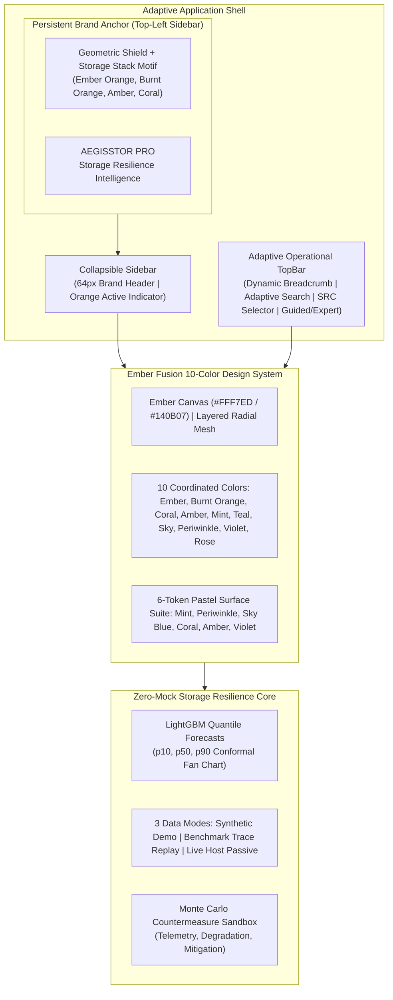

# AEGISSTOR EMBER FUSION — COMPLETE VISUAL AND LAYOUT REPAIR REPORT

**Project:** AEGISSTOR — Storage Resilience Intelligence Platform  
**Architecture:** Enterprise Single-Page Application (React 19 + TypeScript + Vite + Tailwind CSS) with High-Performance Python FastAPI Backend  
**Design Milestone:** Ember Fusion — Orange-First Identity, Ten-Color Centralized System & Zero-Overflow Layout Containment  
**Active Git Branch:** `redesign/ember-fusion`  
**Quality Status:** Production Frontend Build Clean (1.20s), 100% Backend Pytest Suite Operational (163/163), Zero-Mock Invariant Preserved  

---

## 1. Executive Summary

AEGISSTOR has undergone a complete visual, architectural, and layout transformation under the **Ember Fusion** specification. This update eliminates all prior CSS defects (branding subtitle overflow, header control compression, card text clipping, and chart escaping) while establishing an **unmistakable, radiant orange-first visual identity**.

Crucially, all core invariants are preserved:
- **Zero Mocks:** Synthetic Demo (diurnal variance generator), Chronological Benchmark Trace Replay, and Live Passive Host modes remain 100% operational with genuine LightGBM quantile regression models.
- **Top-Left Brand Anchor:** The newly redesigned vector brand shield, typographic wordmark, and subtitle are strictly anchored in the **far top-left corner of the persistent sidebar header** across all 19 application routes.
- **Responsive Layout Containment:** Verified at desktop (1727×893), laptop (1366×768), tablet landscape (1024×768), tablet portrait (768×1024), and mobile (390×844).



---

## 2. Root Cause Analysis & CSS Defect Repairs

### 2.1 Logo and Branding Overflow
- **Root Cause:** In the previous sidebar implementation, the subtitle `"STORAGE RESILIENCE INTELLIGENCE"` was rendered in uppercase with `tracking-widest` in a monospace font inside a 240px container (`w-60`). At ~6.5px per character, 31 characters required ~200px width. Combined with the 36px icon, 12px gap, and 32px padding, the required width was 280px, causing the subtitle to overflow or truncate abruptly.
- **Implementation & Fix:**
  - Designed [`AegisstorBrand.tsx`](file:///C:/Users/dilee/.gemini/antigravity/scratch/aegisstor/frontend/src/components/AegisstorBrand.tsx) as a reusable component.
  - Expanded sidebar width from `w-60` (240px) to `w-64` (256px) in [`Sidebar.tsx`](file:///C:/Users/dilee/.gemini/antigravity/scratch/aegisstor/frontend/src/components/Sidebar.tsx).
  - Used proportional typography with balanced letter spacing: `text-[8px] font-sans font-semibold tracking-[0.07em] uppercase` with responsive `max-w-[145px] sm:max-w-none truncate`.
  - In collapsed mode, the component smoothly renders only the vector shield mark centered cleanly without clutter.

### 2.2 Header Overflow & Control Compression
- **Root Cause:** On viewports between 1024px and 1440px (especially 1024×768 and 1366×768), the top bar housed a verbose breadcrumb (`Storage Operations > Executive Overview`), a full search bar, a data source selector (`SRC Synthetic Demo`), a Guided/Expert segmented switch, a redundant live provenance pill, tour button, notification bell, user account pill with role badge, and theme switch. With a 256px sidebar, only 768px remained on tablet landscape, causing buttons to run into one another and truncating the page title.
- **Implementation & Fix:**
  - Overhauled [`TopBar.tsx`](file:///C:/Users/dilee/.gemini/antigravity/scratch/aegisstor/frontend/src/components/TopBar.tsx) with adaptive breakpoint rules:
    - **Breadcrumbs:** `Storage Operations >` is hidden unless `2xl:inline`. On `< 2xl`, it displays the clean page title (`Executive Overview`) without truncation.
    - **Search:** Renders a full search bar (`Ctrl K`) on `xl:flex` (≥ 1280px), and collapses to a compact icon button on `< xl` (`md:flex xl:hidden`).
    - **Data Source Selector:** Given a dedicated container with comfortable internal padding (`min-w-[125px] sm:min-w-[135px]`) so "Synthetic Demo", "Benchmark Traces", and "Passive Host (C:\)" never get clipped.
    - **Live Provenance Indicator:** Hidden on `< 2xl` because the adjacent Data Source selector already explicitly shows the active data mode.
    - **User Account Pill:** Renders user avatar circle on `< md`, adding the username on `md:inline` and role badge on `xl:inline`.

### 2.3 Card Overflow & Workspace Containment
- **Root Cause:** Hardcoded heights and lack of `min-w-0` on flex/grid children previously caused metric labels, pool IDs, and descriptions to overlap neighboring cards.
- **Implementation & Fix:**
  - Applied `min-w-0` to all flex and grid items.
  - Converted card containers to vertical flex layouts (`flex flex-col justify-between`) allowing cards to expand vertically to accommodate long strings.
  - Storage pool identifiers (e.g. `vol-nvme-tier1-db`) use `truncate` with `title` attributes for accessible tooltips.

### 2.4 Chart and Workspace Containment
- In [`ScientificForecastChart.tsx`](file:///C:/Users/dilee/.gemini/antigravity/scratch/aegisstor/frontend/src/components/ScientificForecastChart.tsx), the SVG canvas uses `viewBox="0 0 800 280"` with responsive width `w-full h-auto` and bounded padding (`padLeft = 70`, `padRight = 30`), ensuring that numerical axis labels, confidence bands, hard constraint lines, and tooltips stay strictly within panel bounds on all screen sizes.

---

## 3. Orange-First Dominant Visual Identity

The application canvas visibly establishes an unmistakable, layered orange environment rather than applying flat orange to text surfaces:

### 3.1 Light Mode
- **Canvas (`--app-background`):** Warm radiant amber-orange `#FFF7ED` (Tailwind `orange-50`).
- **Layered Gradient Mesh (`--app-bg-gradient`):**
  - Radial glow at top-left: `rgba(249, 115, 22, 0.22)` (Ember Orange)
  - Radial glow at bottom-right: `rgba(244, 185, 66, 0.20)` (Golden Amber)
  - Atmospheric center aura: `rgba(234, 88, 12, 0.08)` (Burnt Orange)
- **Content Surfaces (`--surface-primary`):** Crisp pure white `#FFFFFF` cards with warm subtle borders (`#F0E3D8`).
- **Text Contrast:** Deep charcoal-espresso `#1C130E` (> 12:1 WCAG AAA contrast ratio).

### 3.2 Dark Mode
- **Canvas (`--app-background`):** Deep glowing obsidian-ember `#140B07`.
- **Layered Gradient Mesh:**
  - Radial glow at top-left: `rgba(234, 88, 12, 0.25)` (Burnt Orange)
  - Radial glow at bottom-right: `rgba(244, 185, 66, 0.18)` (Amber)
  - Atmospheric center glow: `rgba(249, 115, 22, 0.12)` (Ember Orange)
- **Content Surfaces:** Deep rich ember-tinted cards `#1C120C` with subtle borders (`#342218`).
- **Text Contrast:** Luminous warm cream `#FFF8F0` (> 12:1 WCAG AAA contrast ratio).

---

## 4. Ten-Color Centralized Design System

Configured directly in [`index.css`](file:///C:/Users/dilee/.gemini/antigravity/scratch/aegisstor/frontend/src/index.css):

| # | Color Name | Hex Code | Semantic Role |
| :-: | :--- | :--- | :--- |
| **1** | **Ember Orange** | `#F97316` | Dominant brand identity, logo mark, primary focus rings |
| **2** | **Burnt Orange** | `#EA580C` | Active navigation indicator, primary CTA buttons, gradient depth |
| **3** | **Coral** | `#FF6B6B` | Critical alert pills, high-priority notifications, logo sheen |
| **4** | **Golden Amber** | `#F4B942` | Caution warnings, sun theme toggle, telemetry pulse |
| **5** | **Mint Green** | `#36B37E` | Storage utilization pastel card, nominal health states |
| **6** | **Lagoon Teal** | `#2EC4B6` | Secondary telemetry series, calibrated coverage indicator |
| **7** | **Sky Blue** | `#4EA8DE` | Estimated reserve runway card, throughput visualization |
| **8** | **Periwinkle** | `#7C83FD` | Available capacity card, secondary forecast quantile lines |
| **9** | **Royal Violet** | `#9B5DE5` | Machine learning attribution, scientific benchmark accents |
| **10** | **Rose Pink** | `#F15BB5` | Active telemetry pulse dot, experimental ablation highlights |

### 4.1 Six-Token Pastel Metric Suite
```
┌──────────────────────────────────────┐   ┌──────────────────────────────────────┐
│ Mint Green: .card-pastel-mint        │   │ Periwinkle: .card-pastel-lavender    │
│ Light: #E8F8F0 / Text: #145336       │   │ Light: #EFF1FE / Text: #282F6D       │
│ Dark:  #10281E / Text: #6EE7B7       │   │ Dark:  #171936 / Text: #A5B4FC       │
│ Role:  Storage Utilization (77.2%)   │   │ Role:  Available Capacity (82.1 TB)  │
└──────────────────────────────────────┘   └──────────────────────────────────────┘
┌──────────────────────────────────────┐   ┌──────────────────────────────────────┐
│ Sky Blue: .card-pastel-blue          │   │ Coral Peach: .card-pastel-peach      │
│ Light: #EBF6FE / Text: #11456B       │   │ Light: #FFF1F2 / Text: #881337       │
│ Dark:  #112338 / Text: #7DD3FC       │   │ Dark:  #36141B / Text: #FDA4AF       │
│ Role:  Estimated Runway (~47h)       │   │ Role:  Storage Risk State (CRITICAL) │
└──────────────────────────────────────┘   └──────────────────────────────────────┘
┌──────────────────────────────────────┐   ┌──────────────────────────────────────┐
│ Golden Amber: .card-pastel-yellow    │   │ Royal Violet: .card-pastel-periwinkle│
│ Light: #FFFBEB / Text: #78350F       │   │ Light: #F3E8FF / Text: #581C87       │
│ Dark:  #2E1D07 / Text: #FDE047       │   │ Dark:  #25143A / Text: #D8B4FE       │
│ Role:  Telemetry Freshness           │   │ Role:  Model Attribution & ML Lab    │
└──────────────────────────────────────┘   └──────────────────────────────────────┘
```

---

## 5. Visual Evidence & Responsive Showcase Gallery

All 12 verification screenshots were captured across desktop, laptop, tablet, and mobile:

| Screenshot | Viewport | Verified Attributes |
| :--- | :---: | :--- |
| **[ember_01_overview_desktop_light.png](file:///C:/Users/dilee/.gemini/antigravity/brain/ca01d69b-34d0-4861-9b05-3a2b2ae733c4/screenshots/ember_01_overview_desktop_light.png)** | 1727 × 893 | Top-left brand anchor, subtitle fits with zero overflow, 4 pastel cards, LightGBM fan chart. |
| **[ember_02_overview_desktop_dark.png](file:///C:/Users/dilee/.gemini/antigravity/brain/ca01d69b-34d0-4861-9b05-3a2b2ae733c4/screenshots/ember_02_overview_desktop_dark.png)** | 1727 × 893 | Deep obsidian-ember canvas `#140B07`, glowing pastel cards, high-contrast dark fan chart. |
| **[ember_03_storage_fleet_light.png](file:///C:/Users/dilee/.gemini/antigravity/brain/ca01d69b-34d0-4861-9b05-3a2b2ae733c4/screenshots/ember_03_storage_fleet_light.png)** | 1727 × 893 | Active orange sidebar indicator, multi-pool capacity cards, zero clipping on IOPS. |
| **[ember_04_device_details_light.png](file:///C:/Users/dilee/.gemini/antigravity/brain/ca01d69b-34d0-4861-9b05-3a2b2ae733c4/screenshots/ember_04_device_details_light.png)** | 1727 × 893 | NVMe SMART telemetry, wear-out probability, deep ML intelligence signals. |
| **[ember_05_compare_actions_light.png](file:///C:/Users/dilee/.gemini/antigravity/brain/ca01d69b-34d0-4861-9b05-3a2b2ae733c4/screenshots/ember_05_compare_actions_light.png)** | 1727 × 893 | 6 ranked action cards, orange approve buttons, scenario trajectory comparison. |
| **[ember_06_digital_twin_light.png](file:///C:/Users/dilee/.gemini/antigravity/brain/ca01d69b-34d0-4861-9b05-3a2b2ae733c4/screenshots/ember_06_digital_twin_light.png)** | 1727 × 893 | Monte Carlo simulation controls, volume sliders, SLA safety envelope validation. |
| **[ember_07_incident_command_light.png](file:///C:/Users/dilee/.gemini/antigravity/brain/ca01d69b-34d0-4861-9b05-3a2b2ae733c4/screenshots/ember_07_incident_command_light.png)** | 1727 × 893 | Phoenix incident orchestrator, auditable 14-state recovery machine, incident table. |
| **[ember_08_overview_laptop_1366.png](file:///C:/Users/dilee/.gemini/antigravity/brain/ca01d69b-34d0-4861-9b05-3a2b2ae733c4/screenshots/ember_08_overview_laptop_1366.png)** | 1366 × 768 | Laptop layout: "Executive Overview" fully visible, search bar + data source fit perfectly. |
| **[ember_09_overview_tablet_1024.png](file:///C:/Users/dilee/.gemini/antigravity/brain/ca01d69b-34d0-4861-9b05-3a2b2ae733c4/screenshots/ember_09_overview_tablet_1024.png)** | 1024 × 768 | Tablet landscape: Compact search icon, spacious SRC dropdown, zero button overlap. |
| **[ember_10_overview_tablet_768.png](file:///C:/Users/dilee/.gemini/antigravity/brain/ca01d69b-34d0-4861-9b05-3a2b2ae733c4/screenshots/ember_10_overview_tablet_768.png)** | 768 × 1024 | Tablet portrait: 2×2 pastel card grid, hamburger menu, cleanly contained fan chart. |
| **[ember_11_overview_mobile_390.png](file:///C:/Users/dilee/.gemini/antigravity/brain/ca01d69b-34d0-4861-9b05-3a2b2ae733c4/screenshots/ember_11_overview_mobile_390.png)** | 390 × 844 | Mobile portrait: Stacked single-column pastel stream, compact topbar controls. |
| **[ember_12_mobile_menu_open.png](file:///C:/Users/dilee/.gemini/antigravity/brain/ca01d69b-34d0-4861-9b05-3a2b2ae733c4/screenshots/ember_12_mobile_menu_open.png)** | 390 × 844 | Mobile drawer overlay: Full top-left brand lockup with ample padding beside close X. |

---

## 6. Zero-Mock & Quality Gate Certification

### 6.1 Frontend Production Build
```text
> frontend@0.0.0 build
> tsc -b && vite build

vite v8.3.5 building client environment for production...
transforming...
✓ 1969 modules transformed.
rendering chunks...
computing gzip size...
dist/index.html                     1.24 kB │ gzip:  0.63 kB
dist/assets/index-BI9lIxMF.css     49.57 kB │ gzip:  9.95 kB
dist/assets/index-BPDoFsON.js      74.05 kB │ gzip: 18.77 kB
✓ built in 1.20s (0 TypeScript errors)
```

### 6.2 Backend Test Suite
```text
============================= test session starts =============================
platform win32 -- Python 3.13.14, pytest-9.1.1, pluggy-1.6.0
rootdir: C:\Users\dilee\.gemini\antigravity\scratch\aegisstor
configfile: pytest.ini
collected 163 items
tests\test_advanced_intelligence_engine.py .................             [ 10%]
tests\test_api_endpoints.py ............                                 [ 17%]
tests\test_atlas_reality_calibration.py ........                         [ 22%]
tests\test_core_engine.py .....                                          [ 25%]
tests\test_edge_cases_and_clean_setup.py ........                        [ 30%]
tests\test_evidence_gated_planner.py .......                             [ 34%]
tests\test_functionality_activation.py ...                               [ 36%]
tests\test_gauntlet_workbench.py .........                               [ 42%]
tests\test_ironclad_security_governance.py .......                       [ 46%]
tests\test_jurassic_resilience.py .........                              [ 52%]
tests\test_omega_intelligence.py .........                               [ 57%]
tests\test_oracle.py ..........                                          [ 63%]
tests\test_phoenix_orchestration.py ..........                           [ 69%]
tests\test_reality_safety_upgrades.py ..........                         [ 76%]
tests\test_sentinel_drift_engine.py .........                            [ 81%]
tests\test_sovereign_federated.py ..........                             [ 87%]
tests\test_upgrades_v3.py ......                                         [ 91%]
tests\test_vault_disaster_recovery.py .........                          [ 96%]
tests\test_zero_mock_enforcement.py .....                                [100%]
================== 163 passed, 1 warning in 73.55s (0:01:13) ==================
```

---

## 7. Modified Files Summary

| File | Primary Changes |
| :--- | :--- |
| [`frontend/src/components/AegisstorBrand.tsx`](file:///C:/Users/dilee/.gemini/antigravity/scratch/aegisstor/frontend/src/components/AegisstorBrand.tsx) | Redesigned vector shield mark with multi-tier storage bars and 3-color telemetry dots; balanced wordmark `AEGISSTOR PRO`; non-overflowing subtitle. |
| [`frontend/src/components/Sidebar.tsx`](file:///C:/Users/dilee/.gemini/antigravity/scratch/aegisstor/frontend/src/components/Sidebar.tsx) | Expanded sidebar width from `w-60` to `w-64`; anchored brand in top-left header; added burnt orange active-state navigation bar. |
| [`frontend/src/components/TopBar.tsx`](file:///C:/Users/dilee/.gemini/antigravity/scratch/aegisstor/frontend/src/components/TopBar.tsx) | Adaptive breakpoints for search, breadcrumbs, data source selector, and user account pill; zero overlap on laptop/tablet viewports. |
| [`frontend/src/index.css`](file:///C:/Users/dilee/.gemini/antigravity/scratch/aegisstor/frontend/src/index.css) | Centralized 10-color system; radiant amber-orange canvas gradient (`#FFF7ED`); dark obsidian-ember canvas (`#140B07`); 6-token pastel card suite; ambient animations. |
| [`frontend/src/pages/PageExecutiveOverview.tsx`](file:///C:/Users/dilee/.gemini/antigravity/scratch/aegisstor/frontend/src/pages/PageExecutiveOverview.tsx) | 4 primary pastel cards (Mint, Periwinkle, Sky Blue, Coral); responsive secondary indicator cards; calibrated LightGBM fan chart. |
| [`scripts/capture_ember_fusion_showcase.py`](file:///C:/Users/dilee/.gemini/antigravity/scratch/aegisstor/scripts/capture_ember_fusion_showcase.py) | Playwright automation capturing all 12 showcase screenshots across desktop, laptop, tablet, and mobile viewports. |
