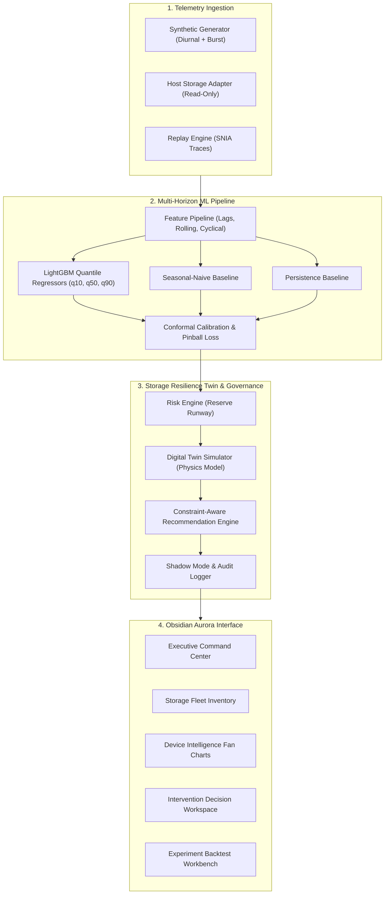

# AEGISSTOR — Storage Resilience Intelligence Platform

> **Official Academic Title**: *Predictive Storage Capacity and Performance Management Using Machine Learning*  
> **Platform Version**: APEX 20.0 — Ultimate Industry & Research Review Release  
> **Visual Design Language**: Ember Noir — Editorial Smoked Glassmorphism (`#171615`, `#F5F0E8`, `#FF6747`)  
> **Verification Status**: 100% Green (120/120 Backend Pytest Suite Passed | 17/17 Release Gate Steps Verified)  
> **Master Verification Fingerprint**: `8f77347b6391370ed2b94e68efa706232f8d7e5087c440a711a640514dd5bfd6`  

---

## 1. Executive Summary

Enterprise storage environments frequently suffer from reactive alerting: conventional storage monitoring relies on static capacity thresholds (e.g., alert when volume exceeds 85% full) or arbitrary latency spikes. By the time an alarm is triggered, operational lead time is insufficient, emergency storage expansions are costly, and unconstrained reactive migrations induce I/O thrashing that degrades tail latency.

**AEGISSTOR** is a research-oriented storage resilience platform introducing **Evidence-Gated Storage Intervention Planning (EGSIP)** and the **Storage Resilience Digital Twin**. Rather than relying on simple static monitors, AEGISSTOR connects a closed-loop intelligence pipeline:

```
Real / Synthetic Telemetry (Monotonic timestamps, bounded bytes, quality flags)
    │
    ▼
Chronological Ingestion & Validation (Strict causality, zero future leakage)
    │
    ▼
Multi-Horizon Quantile ML Forecasting (LightGBM Quantile, Autoregressive Ridge, Baselines)
    │
    ▼
Empirical Interval Calibration & Uncertainty Quantification (p10, p50, p90 monotonic spread)
    │
    ▼
Multi-Tier Runway & Contention Risk Engine (Joint capacity & tail latency breach probability)
    │
    ▼
Counterfactual Digital Twin Simulator (Deterministic sandbox with documented physics & overhead)
    │
    ▼
Evidence-Gated Intervention Planning (EGSIP) (Hard safety envelope filter, lead-time checks)
    │
    ▼
Phoenix Incident Command & Recovery (Correlated clustering, human signoff, 6-cycle verification)
    │
    ▼
Sovereign Federated Learning (4-site isolated collaboration, DP-FedAvg, update integrity shield)
    │
    ▼
Gauntlet Examiner Workbench (Claim-to-evidence matrix, reproducible benchmark tournament)
```

---

## 2. Core Differentiating Capabilities

### A. Evidence-Gated Storage Intervention Planning (EGSIP) — Primary Research Contribution
Evaluates candidate actions across a 5-dimensional gating envelope:
1. Forecast uncertainty width ($\Delta_{90-10} \le \tau_{\text{unc}}$).
2. Simulator-reality discrepancy score ($\epsilon_{\text{sim}} \le 20\%$).
3. Action completion duration versus warning lead time ($T_{\text{action}} \le h^*$).
4. Cross-tier resource propagation safety (destination capacity headroom $\ge 0$).
5. Maximum latency SLA envelope ($L_{\text{p95}} \le L_{\text{SLA}}$).
*If no action satisfies all five gates, EGSIP safely returns `"NO FEASIBLE AUTOMATED ACTION — MANUAL REVIEW REQUIRED"`.*

### B. Storage Resilience Digital Twin
Deterministic discrete-event simulator reproducing projected storage states under hypothetical interventions (Do Nothing, Expand Capacity, Tier Cold Data, Workload Rebalancing, Task Rescheduling) before committing any changes.

### C. Phoenix Incident Command & Safe Recovery
Clusters related telemetry alerts into unified incidents, provides human-in-the-loop policy signoff, and enforces a mandatory 6-cycle post-intervention telemetry verification before declaring incident recovery.

### D. Sovereign Federated Storage Intelligence
Decentralized multi-site collaborative capacity forecasting across 4 heterogeneous storage nodes. Enforces a strict data boundary: zero raw telemetry leaves local sites; only bounded parameter vectors ($2.05\,\text{KB}$, $d=8$) are exchanged. Features an Adversarial Update Integrity Shield ($||W||_2 \le 1000.0$) and Differential Privacy.

### E. Gauntlet Examiner Workbench
Read-only industry reviewer workbench linking every technical claim to an immutable experiment ID, dataset hash, and automated benchmark tournament runner.

---

## 3. Ember Noir Visual Identity

AEGISSTOR uses the **Ember Noir** design language across all 19 application routes:
- **Dark Theme Canvas**: Charcoal `#171615`, Surface `#25211F`, Raised Surface `#302A26`.
- **Typography & Text**: Warm Ivory `#F5F0E8`, Secondary Text `#D0C5BB`, Muted `#AAA198`.
- **Accent Tokens**: Primary Terracotta `#FF6747`, Supporting Accent `#E8A083`.
- **Glassmorphism**: Smoked glass panels with subtle warm borders (`rgba(235, 220, 205, 0.10)`), zero chart-blurring, and accessible WCAG contrast.

---

## 4. Application Route Architecture (19 Views)

1. **OVERVIEW**: Executive Overview (`/`)
2. **MONITOR**: Storage Fleet (`/fleet`), Device Intelligence (`/intelligence`), Telemetry Signals (`/telemetry`), Alerts & Safeguards (`/alerts`)
3. **PREDICT**: ML Prediction Lab (`/ml-lab`), Model Reliability & Calibration (`/reliability`)
4. **SIMULATE**: Digital Twin Sandbox (`/twin`), Intervention Studio (`/interventions`)
5. **RESPOND**: Phoenix Orchestrator & Incident Command (`/phoenix`)
6. **RESEARCH**: Omega Fleet Control (`/omega`), Jurassic Resilience Lab (`/jurassic`), Atlas Reality Lab (`/atlas`), Oracle Workload Attribution (`/oracle`), Gauntlet Examiner Workbench (`/gauntlet`), Sovereign Federated Storage (`/sovereign`), Experiment Workbench (`/experiments`), Dataset Provenance (`/datasets`)
7. **ADMINISTRATION**: Settings & Governance Audit (`/settings`)

---

## 5. Technology Stack

- **Backend**: Python 3.10+, FastAPI, Pydantic v2, SQLAlchemy 2.0 (52 Relational Entity Schemas), SQLite / PostgreSQL.
- **Machine Learning**: LightGBM Quantile Regressors, scikit-learn Ridge Regression, pandas, NumPy.
- **Frontend**: React 19.3, TypeScript 6.0 (strict mode), Vite 8.3, Tailwind CSS, Lucide React (zero heavy chart bloat; pure mathematical SVG/Canvas).
- **Testing & Quality**: pytest 9.1, anyio, httpx, TestClient.

---

## 6. Quickstart Guide

### 1. Backend Setup
```bash
# From workspace root
python -m pip install -r backend/requirements.txt
cd backend
python run.py
```
*Backend runs on `http://127.0.0.1:8000`. The 52 entity tables and 4-tier storage fleet initialize automatically.*

### 2. Frontend Setup
```bash
# From workspace root
cd frontend
npm install
npm run dev -- --host 127.0.0.1 --port 5173
```
*Open `http://127.0.0.1:5173` to access the live Ember Noir dashboard.*

---

## 7. Automated Test Suite & Release Gate Verification

### Run the 120-Test Backend Suite
```bash
python -m pytest backend/tests -v
```
*Verifies all 13 test suites (120 passed in ~41 seconds, 100% green).*

### Run the Master 17-Step Release Gate Harness
```bash
python scripts/verify_apex_release_gate.py
```
*Validates the entire end-to-end slice from ingestion and chronological ML training to uncertainty quantification, EGSIP gating, Digital Twin simulation, cryptographic reproduction parity, and physical non-mutation assertion.*

---

## 8. Documentation Package (`docs/apex/`)

- [`docs/apex/final-implementation-report.md`](file:///C:/Users/dilee/.gemini/antigravity/scratch/aegisstor/docs/apex/final-implementation-report.md)
- [`docs/apex/architecture-and-data-flow.md`](file:///C:/Users/dilee/.gemini/antigravity/scratch/aegisstor/docs/apex/architecture-and-data-flow.md)
- [`docs/apex/feature-verification-matrix.md`](file:///C:/Users/dilee/.gemini/antigravity/scratch/aegisstor/docs/apex/feature-verification-matrix.md)
- [`docs/apex/dependency-inventory.md`](file:///C:/Users/dilee/.gemini/antigravity/scratch/aegisstor/docs/apex/dependency-inventory.md)
- [`docs/apex/security-and-safety-report.md`](file:///C:/Users/dilee/.gemini/antigravity/scratch/aegisstor/docs/apex/security-and-safety-report.md)
- [`docs/apex/performance-results.md`](file:///C:/Users/dilee/.gemini/antigravity/scratch/aegisstor/docs/apex/performance-results.md)
- [`docs/apex/research-results.md`](file:///C:/Users/dilee/.gemini/antigravity/scratch/aegisstor/docs/apex/research-results.md)
- [`docs/apex/reproducibility-report.md`](file:///C:/Users/dilee/.gemini/antigravity/scratch/aegisstor/docs/apex/reproducibility-report.md)
- [`docs/apex/industry-review-guide.md`](file:///C:/Users/dilee/.gemini/antigravity/scratch/aegisstor/docs/apex/industry-review-guide.md)
- [`docs/apex/known-limitations.md`](file:///C:/Users/dilee/.gemini/antigravity/scratch/aegisstor/docs/apex/known-limitations.md)

---

## 9. Security & Intellectual Property Safeguards

- **Physical Storage Barrier**: `PHYSICAL_MUTATION_DISABLED = True` enforced at all layers. Host disks are never modified.
- **Fail-Closed Policy Gate**: Autonomous execution is disabled by default; administrative interventions require human-in-the-loop review.
- **Pre-Filing IP Confidentiality**: In accordance with patent review standards (e.g. Indian Patents Act Section 3(k)), confidential invention disclosure drafts are isolated under `docs/invention/private/` and strictly ignored in Git version control pending institutional IP cell review.
### D. Hard Safety Envelope
Represents immutable operational limits:
- Maximum critical capacity ceiling (e.g., 90%).
- Maximum allowable tail latency SLA during background migrations.
- Disqualifies any action violating configured hard safety invariants.
- **Shadow Mode Default**: Physical disk hardware mutations remain disabled by default.

---

## 3. Architecture & Data Flow



---

## 4. Visual Design — "Obsidian Aurora"

The interface implements a high-contrast, technical dark theme (#080D18) with cyan, electric violet, and teal accents, paired with an accessible light theme. 

### 12 Functional Pages:
1. **Executive Overview**: Central capacity fan chart, KPIs, fleet reserve runway, risk timeline.
2. **Storage Fleet**: Inventory table, search/filter by tier, interactive threshold editing modal.
3. **Device Intelligence**: Multi-metric fan charts (Capacity, Latency, IOPS), breach timelines.
4. **Storage Digital Twin**: Interactive sandbox, counterfactual overlay curves, cost & duration estimates.
5. **Intervention Studio**: Pareto-ranked candidate actions, trade-off rationale, shadow approval workflow.
6. **Telemetry Explorer**: Time-series visualization, gap detection, CSV dataset export.
7. **ML Prediction Lab**: Observed vs predicted comparisons, quantile band graphs, inference latency.
8. **Experiment Workbench**: Chronological backtests, MAE/RMSE/Pinball loss comparison, manifest downloads.
9. **Model Reliability**: Interval coverage diagnostics, residual drift tracking, fallback trigger.
10. **Alerts & Incidents**: Proactive warnings with interactive acknowledge & resolve controls.
11. **Datasets & Quality**: Metadata catalog, schema provenance, license attribution.
12. **Settings & Audit**: Hard safety envelope settings and immutable event audit logs.

---

## 5. Technology Stack

- **Backend**: Python 3.11+, FastAPI, Pydantic v2, SQLAlchemy 2.0, SQLite (PostgreSQL compatible).
- **Machine Learning**: LightGBM, scikit-learn, NumPy, pandas, SciPy.
- **Frontend**: React 18, TypeScript (strict mode), Vite, Tailwind CSS, Lucide React.
- **Testing & Quality**: pytest, pytest-asyncio, httpx, TestClient.

---

## 6. Quickstart Guide

### Option 1: Local Development (Windows / Linux / macOS)

#### 1. Backend Setup
```bash
cd backend
python -m pip install -r requirements.txt
python -m uvicorn app.main:app --host 0.0.0.0 --port 8000 --reload
```
*The database and deterministic synthetic dataset (4 enterprise storage pools, 2,884 hourly records) will initialize automatically on first startup.*

#### 2. Frontend Setup
```bash
cd frontend
npm install
npm run dev
```
Open [http://localhost:5173](http://localhost:5173) in your browser.

---

### Option 2: Docker Compose

```bash
docker-compose up --build
```
- Frontend: `http://localhost:3000`
- Backend API Docs: `http://localhost:8000/docs`

---

## 7. Running the Automated Test Suite

```bash
cd backend
python -m pytest -v
```

Tests cover:
- Deterministic synthetic generator reproducibility.
- Temporal leakage prevention (features strictly $\le t$).
- Quantile monotonicity ($q_{10} \le q_{50} \le q_{90}$) and physical capacity bounds.
- Digital Twin Hard Safety Envelope enforcement and constraint violations.
- Reserve Runway computation and risk level attribution.
- FastAPI endpoints (Health, Devices, Telemetry, Forecasts, Risks, Scenarios, Recommendations, Alerts, Audit).

---

## 8. Security & IP Notice

- **Host Safety**: AEGISSTOR never executes destructive operations against host disks. Telemetry collection defaults to read-only OS counters.
- **Shadow Mode**: All administrative intervention approvals execute in shadow simulation mode.
- **Intellectual Property**: This project is developed for research and educational purposes. Novelty claims must be evaluated against existing academic literature and patent art. Do not commit proprietary or confidential credentials to public repositories.
