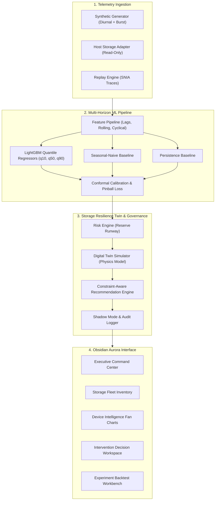

# AEGISSTOR — Storage Resilience Intelligence Platform

> **Official Academic Title**: *Predictive Storage Capacity and Performance Management Using Machine Learning*  
> **System Architecture**: Storage Resilience Digital Twin  
> **Visual Design Language**: Obsidian Aurora — Intelligent Infrastructure  

---

## 1. Executive Summary

Enterprise storage environments frequently suffer from reactive alerting: conventional storage monitoring relies on static capacity thresholds (e.g., alert when volume exceeds 85% full) or arbitrary latency spikes. By the time an alarm is triggered, operational lead time is insufficient, emergency storage expansions are costly, and unconstrained reactive migrations induce I/O thrashing that degrades tail latency.

**AEGISSTOR** is a research-oriented storage resilience platform introducing the **Storage Resilience Digital Twin**. Rather than relying on simple static monitors, AEGISSTOR connects a closed-loop intelligence pipeline:

```
Real / Synthetic Telemetry
    │
    ▼
Data Validation & Provenance Ingestion (schema check, gap detection, outlier flag)
    │
    ▼
Multi-Horizon Quantile ML Forecasting (LightGBM Quantile, Seasonal Naive, Persistence)
    │
    ▼
Empirical Interval Calibration & Uncertainty Quantification (Conformal Coverage, Width)
    │
    ▼
Capacity & Latency Risk Envelope (Joint multi-target breach probability, Reserve Runway)
    │
    ▼
Counterfactual Intervention Studio (Deterministic simulator with documented physics/assumptions)
    │
    ▼
Constraint-Aware Recommendation Engine (Hard safety envelope filter, Pareto/multi-criteria ranking)
    │
    ▼
Human Approval & Governance (Shadow mode by default, audit logging, dual-approval workflow)
    │
    ▼
Outcome Tracking & Closed-Loop Model Evaluation (Drift detection, backtesting, ablation)
```

---

## 2. Core Differentiating Capabilities

### A. Risk Envelope
Forecasts future storage capacity utilization, free space, read/write IOPS, throughput, and P95 tail latency across multi-step horizons (24h, 72h, 168h). Non-parametric prediction intervals ($[q_{10}, q_{90}]$) explicitly convey forecast uncertainty alongside configurable service level constraints.

### B. Reserve Runway
Estimates the operational time remaining ($T_{\text{breach}}$) before available storage capacity or latency thresholds are breached. Provides both point estimates ($q_{50}$) and conservative lower bounds ($q_{90}$) based on empirical error distributions.

### C. Counterfactual Intervention Studio (The Digital Twin)
Clones current storage geometry, capacity, and performance state to simulate hypothetical administrative actions before committing changes to physical infrastructure:
- **Do Nothing**: Tracks baseline risk under predicted natural workload growth.
- **Expand Capacity**: Simulates online LUN volume growth (+2TB, +5TB), calculating lead times and provisioning cost.
- **Tier Cold Data**: Models asynchronous migration of inactive blocks (>30 days) to secondary object storage, computing transient I/O migration penalties and duration.
- **Reschedule Tasks**: Shifts intensive background jobs (RAID scrubbing, backups) to off-peak hours (02:00–05:00 UTC).
- **Rebalance Workload**: Relocates noisy tenant database partitions across neighboring pools.

### D. Hard Safety Envelope
Represents immutable operational limits:
- Maximum critical capacity ceiling (e.g., 90%).
- Maximum allowable tail latency SLA during background migrations.
- Disqualifies any action violating configured hard safety invariants.
- **Shadow Mode Default**: Physical disk hardware mutations remain disabled by default.

---

## 3. Architecture & Data Flow



---

## 4. Visual Design — "Obsidian Aurora"

The interface implements a high-contrast, technical dark theme (#080D18) with cyan, electric violet, and teal accents, paired with an accessible light theme. 

### 12 Functional Pages:
1. **Executive Overview**: Central capacity fan chart, KPIs, fleet reserve runway, risk timeline.
2. **Storage Fleet**: Inventory table, search/filter by tier, interactive threshold editing modal.
3. **Device Intelligence**: Multi-metric fan charts (Capacity, Latency, IOPS), breach timelines.
4. **Storage Digital Twin**: Interactive sandbox, counterfactual overlay curves, cost & duration estimates.
5. **Intervention Studio**: Pareto-ranked candidate actions, trade-off rationale, shadow approval workflow.
6. **Telemetry Explorer**: Time-series visualization, gap detection, CSV dataset export.
7. **ML Prediction Lab**: Observed vs predicted comparisons, quantile band graphs, inference latency.
8. **Experiment Workbench**: Chronological backtests, MAE/RMSE/Pinball loss comparison, manifest downloads.
9. **Model Reliability**: Interval coverage diagnostics, residual drift tracking, fallback trigger.
10. **Alerts & Incidents**: Proactive warnings with interactive acknowledge & resolve controls.
11. **Datasets & Quality**: Metadata catalog, schema provenance, license attribution.
12. **Settings & Audit**: Hard safety envelope settings and immutable event audit logs.

---

## 5. Technology Stack

- **Backend**: Python 3.11+, FastAPI, Pydantic v2, SQLAlchemy 2.0, SQLite (PostgreSQL compatible).
- **Machine Learning**: LightGBM, scikit-learn, NumPy, pandas, SciPy.
- **Frontend**: React 18, TypeScript (strict mode), Vite, Tailwind CSS, Lucide React.
- **Testing & Quality**: pytest, pytest-asyncio, httpx, TestClient.

---

## 6. Quickstart Guide

### Option 1: Local Development (Windows / Linux / macOS)

#### 1. Backend Setup
```bash
cd backend
python -m pip install -r requirements.txt
python -m uvicorn app.main:app --host 0.0.0.0 --port 8000 --reload
```
*The database and deterministic synthetic dataset (4 enterprise storage pools, 2,884 hourly records) will initialize automatically on first startup.*

#### 2. Frontend Setup
```bash
cd frontend
npm install
npm run dev
```
Open [http://localhost:5173](http://localhost:5173) in your browser.

---

### Option 2: Docker Compose

```bash
docker-compose up --build
```
- Frontend: `http://localhost:3000`
- Backend API Docs: `http://localhost:8000/docs`

---

## 7. Running the Automated Test Suite

```bash
cd backend
python -m pytest -v
```

Tests cover:
- Deterministic synthetic generator reproducibility.
- Temporal leakage prevention (features strictly $\le t$).
- Quantile monotonicity ($q_{10} \le q_{50} \le q_{90}$) and physical capacity bounds.
- Digital Twin Hard Safety Envelope enforcement and constraint violations.
- Reserve Runway computation and risk level attribution.
- FastAPI endpoints (Health, Devices, Telemetry, Forecasts, Risks, Scenarios, Recommendations, Alerts, Audit).

---

## 8. Security & IP Notice

- **Host Safety**: AEGISSTOR never executes destructive operations against host disks. Telemetry collection defaults to read-only OS counters.
- **Shadow Mode**: All administrative intervention approvals execute in shadow simulation mode.
- **Intellectual Property**: This project is developed for research and educational purposes. Novelty claims must be evaluated against existing academic literature and patent art. Do not commit proprietary or confidential credentials to public repositories.
