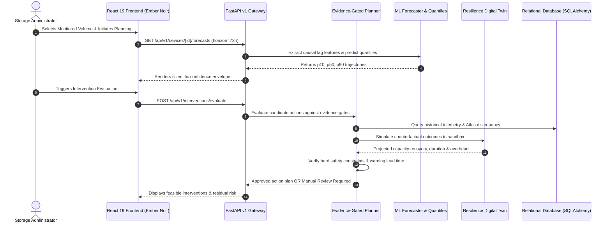

# AEGISSTOR APEX — Architecture & Data Flow Specification (Phase 30)

**Project Title:** Predictive Storage Capacity and Performance Management Using Machine Learning  
**Platform:** AEGISSTOR — Storage Resilience Intelligence Platform  
**Document Code:** APEX-ARCH-002  

---

## 1. Architectural Topology

AEGISSTOR implements a layered, contract-driven architecture designed for reproducible storage intelligence. The architecture cleanly separates presentation, REST API routing, business services, simulation sandboxing, and persistent storage.

---

## 2. Subsystem Boundaries & Invariants

### 1. Telemetry Ingestion Layer
- **Input Formats:** Synthetic generator or Prometheus Node Exporter metrics.
- **Invariants:** Every observation must have positive byte metrics ($U_t > 0, F_t \ge 0$), bounded utilization ($0 \le \% \le 100$), and monotonic timestamps.

### 2. Autoregressive ML Forecasting Layer
- **Models:** Autoregressive Ridge Regression and LightGBM Quantile Regressors ($p_{10}, p_{50}, p_{90}$).
- **Invariants:** Strict chronological partitioning; zero future leakage; feature windows strictly terminate at split cutoff $t \le T_{\text{train}}$.

### 3. Digital Twin Sandboxing Layer
- **Physics Models:** Capacity volume conservation, migration transfer rate functions based on network interconnect bandwidth, and diurnal contention models.
- **Invariants:** 100% in-memory / relational simulation state; zero physical disk `ioctl` or block write commands.

### 4. Evidence-Gated Planning (EGSIP) Layer
- **Gating Invariant 1 (Uncertainty):** Disqualifies automation if forecast quantile spread exceeds safety threshold $\Delta_{90-10} > \tau_{\text{unc}}$.
- **Gating Invariant 2 (Fidelity):** Disqualifies automation if Atlas sim-to-real discrepancy exceeds 20%.
- **Gating Invariant 3 (Lead Time):** Disqualifies any action whose completion duration exceeds time-to-critical warning $T_{\text{action}} > h^*$.
- **Gating Invariant 4 (Cross-Resource Propagation):** Disqualifies any action causing destination tier capacity breach or exceeding maximum latency SLAs.
- **Fail-Closed Fallback:** When all candidates fail gates, returns `"NO FEASIBLE AUTOMATED ACTION — MANUAL REVIEW REQUIRED"`.
