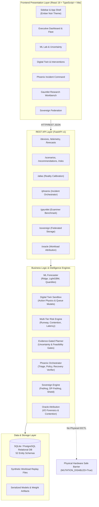

# AEGISSTOR APEX — Current Architecture & Data Flow (Phase 0)

**Project Title:** Predictive Storage Capacity and Performance Management Using Machine Learning  
**Platform:** AEGISSTOR — Storage Resilience Intelligence Platform  
**Document Code:** APEX-ARCH-001  
**Architecture Classification:** Modular Monolithic Engine with Strict Service Domain Boundaries  

---

## 1. Architectural Philosophy

AEGISSTOR avoids premature distributed microservice overhead by implementing a strictly bounded, high-cohesion, low-coupling **Modular Monolithic Architecture**. All data mutations flow through transactional service contracts, deterministic mathematical physics, and auditable governance gates.

---

## 2. Core Domain Boundaries & Responsibilities

| Subsystem | Service Module | Primary Responsibilities |
| :--- | :--- | :--- |
| **Telemetry Ingestion** | `collector/` | Imports, validates, and standardizes physical or synthetic telemetry. Validates monotonic timestamps, positive capacity bounds, and unit consistency (Bytes, MB/s, ms). |
| **Forecasting Engine** | `ml/`, `capacity_runway_engine.py` | Chronologically split training without temporal leakage. Fits autoregressive Ridge, LightGBM, and persistence baselines; computes $p_{10}, p_{50}, p_{90}$ prediction intervals. |
| **Resilience Digital Twin** | `simulator/`, `scenarios.py` | Deterministic counterfactual simulation of capacity expansion, cold tiering, deduplication, and IO throttling across configured horizons (7, 14, 30, 90 days). |
| **Evidence-Gated Planner** | `evidence_gated_planner.py` | **Primary Candidate Contribution:** Evaluates forecast uncertainty, simulator discrepancy, evidence freshness, and safety constraints before proposing intervention. Rejects infeasible actions. |
| **Workload Forensics** | `services/oracle/` | Workload attribution, contention factor analysis, queue depth correlation, and counterfactual mitigation evaluation. |
| **Safe Incident Recovery** | `services/phoenix/` | Correlated incident clustering, runbook generation, human-in-the-loop policy approval gate, and post-action telemetry recovery verification. |
| **Examiner Workbench** | `services/gauntlet_service.py` | Reproducible benchmark execution, claim-to-evidence matrix validation, cryptographic experiment run hashing, and examiner report generation. |
| **Federated Storage** | `services/sovereign_service.py` | 4-site isolated decentralized learning simulation. Supports FedAvg, Reliability-Aware weighting, Personalized adaptation, and $(\epsilon, \delta)$ Differential Privacy. |

---

## 3. Data Flow Pathways

### Pathway A: Telemetry Ingestion & Risk Scoring
1. **Source:** Synthetic workload replay or Prometheus node exporter collects metrics at 1-minute intervals.
2. **Ingestion & Validation:** `collector/` asserts non-null timestamps, validates device identifiers, verifies $0 \le \text{utilization} \le 100\%$, and writes to the `telemetry` table.
3. **Forecasting:** `CapacityRunwayEngine` extracts causal lag and diurnal features, generates median forecast and $p_{10}$/$p_{90}$ bounds.
4. **Risk Calculation:** `RiskEngine` calculates days-to-breach (80% warning, 90% critical) and evaluates latency degradation risk.

### Pathway B: Evidence-Gated Intervention Planning
1. **Trigger:** Runway breach predicted within $< 14$ days or queue contention alert triggered.
2. **Candidate Generation:** `ActionPlanner` generates candidate actions (e.g., `EXPAND_VOLUME`, `TIER_COLD_DATA`, `THROTTLE_WORKLOAD`).
3. **Evidence Gating:**
   - Evaluates prediction interval width $\Delta_{90-10}$; if variance is excessive, flags uncertainty gate breach.
   - Evaluates Atlas reality calibration discrepancy; if simulation error $> 15\%$, requires human verification.
   - Verifies target device capacity headroom and maximum acceptable latency constraints.
4. **Outcome:** Returns an approved intervention proposal or explicitly emits `"NO FEASIBLE AUTOMATED ACTION — MANUAL REVIEW REQUIRED"`.

### Pathway C: Incident Orchestration & Safe Recovery
1. **Incident Creation:** Unresolved alerts correlate into an active `PhoenixIncident`.
2. **Runbook Selection:** Matched to approved runbook template.
3. **Human Approval:** Policy gate checks permissions; requires operator signoff.
4. **Digital Twin Execution:** Runs in sandbox; measures pre/post delta.
5. **Recovery Verification:** Monitors telemetry for 6 consecutive cycles to verify stabilization before closing incident.

---

## 4. Hardware Safety Boundary

Physical storage mutation is completely prohibited by architectural invariant:
- All action proposal executions run against in-memory or database-backed Digital Twin simulation states.
- The `action_gateway.py` enforces `PHYSICAL_MUTATION_DISABLED = True` at the core interface.
- Raw block device access, disk wiping, or partitioning tools are never invoked.
