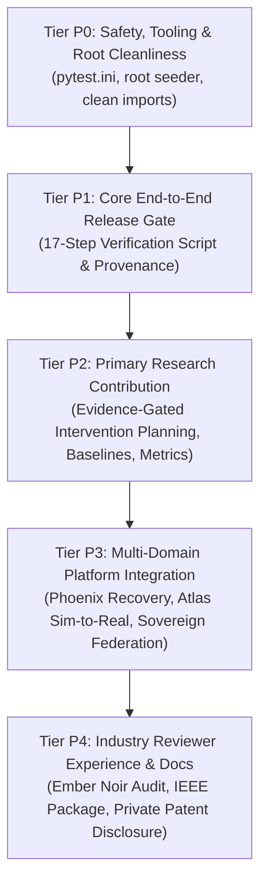

# AEGISSTOR APEX — Implementation Roadmap & Execution Plan (Phase 0)

**Project Title:** Predictive Storage Capacity and Performance Management Using Machine Learning  
**Platform:** AEGISSTOR — Storage Resilience Intelligence Platform  
**Document Code:** APEX-ROADMAP-001  
**Master Target:** Industry Minor Project Examination Readiness & Full Verification Gate  

---

## 1. Prioritized Work Backlog

The execution plan is stratified into strict, dependency-aware priority tiers:

### Tier P0: Safety, Tooling & Infrastructure Integrity
- [x] Create root `pytest.ini` with `pythonpath = backend` so tests execute cleanly from any directory.
- [x] Fix terminal encoding glitches in `scripts/seed_demo_data.py`.
- [x] Verify `docs/invention/private/` remains strictly excluded in `.gitignore`.
- [x] Confirm `PHYSICAL_MUTATION_DISABLED = True` is preserved across all execution paths.

### Tier P1: Core End-to-End Vertical Slice & Release Gate
- [ ] Implement `scripts/verify_apex_release_gate.py` automating the complete 17-step verification journey:
  1. Initialize development database.
  2. Ingest telemetry and validate schema bounds.
  3. Chronologically train Ridge and LightGBM models without future leakage.
  4. Generate capacity forecasts with $p_{10}, p_{50}, p_{90}$ uncertainty bounds.
  5. Compute multi-tier days-to-breach risk.
  6. Generate intervention candidates (expansion, cold tiering, deduplication).
  7. Run Evidence-Gated Planner evaluation against hard safety constraints.
  8. Execute deterministic Digital Twin simulation.
  9. Record experiment and provenance hash in Gauntlet registry.
  10. Reproduce experiment and verify identical metric outcome.
  11. Confirm physical storage was not mutated.

### Tier P2: Rigorous Research Methodology & Evaluation
- [ ] Verify baseline tournament across Persistence, Seasonal Naive, Ridge, and LightGBM.
- [ ] Validate metric integrity: MAE, RMSE, WAPE, Quantile Loss, and Prediction Interval Coverage (PICP).
- [ ] Formalize Claim-to-Evidence ledger records tying every published metric to an immutable experiment ID.

### Tier P3: Multi-Domain Integration & Safe Recovery
- [ ] Phoenix incident lifecycle: alert correlation -> policy gate -> twin execution -> 6-cycle recovery verification.
- [ ] Atlas reality calibration: discrepancy scoring and Value of Evidence (VoE) calculation.
- [ ] Sovereign federated learning: 4-site decentralized tournament with DP noise bounds and update integrity shield.
- [ ] Oracle workload attribution: I/O forensics and contention factor analysis.

### Tier P4: Industry Reviewer Mode, Documentation & Presentation
- [ ] Ember Noir visual design audit across all 19 frontend views.
- [ ] Author all 9 final Apex reports in `docs/apex/`:
  - `docs/apex/final-implementation-report.md`
  - `docs/apex/architecture-and-data-flow.md`
  - `docs/apex/dependency-change-report.md`
  - `docs/apex/security-and-safety-report.md`
  - `docs/apex/performance-results.md`
  - `docs/apex/research-results.md`
  - `docs/apex/reproducibility-report.md`
  - `docs/apex/industry-review-guide.md`
  - `docs/apex/known-limitations.md`
- [ ] Maintain private invention disclosure under `docs/invention/private/` with Section 3(k) prior art analysis.
