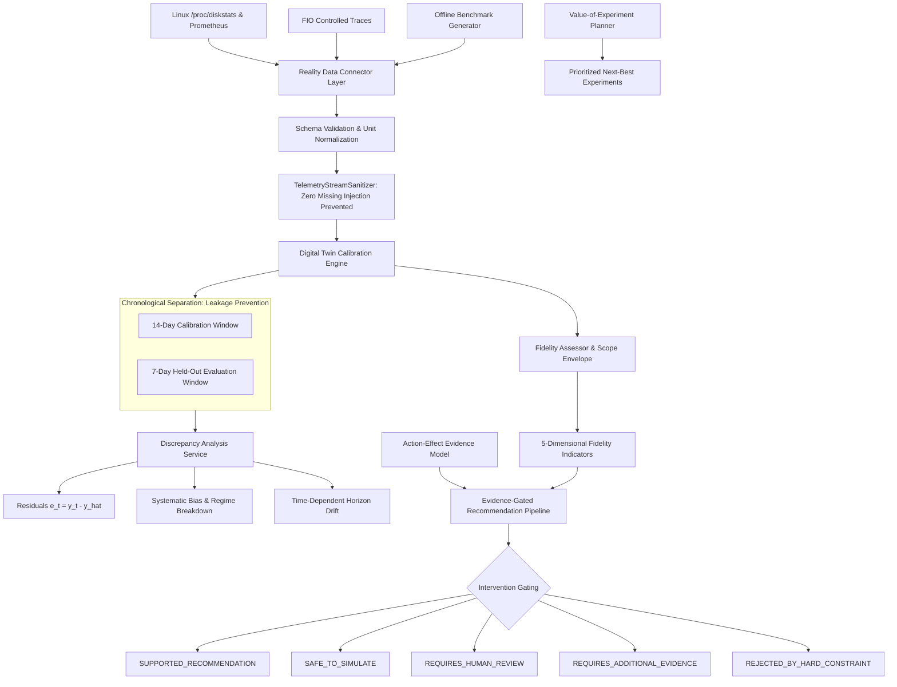

# AEGISSTOR ATLAS — Reality Calibration & Evidence Intelligence
## System Architecture & Technical Specification

### 1. Vision & Architectural Role
AEGISSTOR ATLAS provides a scientifically grounded mechanism for evaluating whether storage forecasts, Digital Twin counterfactuals, and automated intervention proposals are supported by empirical evidence from actual storage systems.

The core principle of ATLAS is **epistemic humility**: the platform must explicitly differentiate between what it knows from physical measurement and what it estimates through mathematical or simulation models.

### 2. Core Pillars of ATLAS
1. **Reality Data Connector Layer**:
   Typed adapters for Linux kernel diskstats, Prometheus metrics, node_exporter counters, and FIO benchmark block traces with unit normalization and provenance tags (`REAL_HARDWARE`, `PUBLIC_BENCHMARK`, `CONTROLLED_EXPERIMENT`, `SYNTHETIC_SIMULATION`).
2. **Chronological Calibration & Leakage Prevention**:
   Strict chronological partition separating training/calibration data from held-out evaluation periods. Parameter calibration is never performed on the evaluation window.
3. **Sim-to-Real Discrepancy Analysis**:
   Residual series calculation ($e_t = y_t - \hat{y}_t$), systematic bias determination, horizon error drift tracking, and workload regime breakdowns (Read-Intensive, Balanced OLTP, Write-Heavy, High Contention).
4. **Action-Effect Evidence Grounding**:
   Explicit categorization of action effects into simulated counterfactuals, controlled experiments, operational ledger outcomes, and theoretical assumptions.
5. **Digital Twin Fidelity Envelope**:
   Five-dimensional fidelity scorecard measuring Prediction Fidelity, Workload Coverage, Data Quality, Calibration Recency, and Action Evidence. Flags out-of-scope conditions with explicit operational warnings.
6. **Evidence-Gated Recommendations**:
   Gating pipeline ensuring candidate actions with weak evidence or out-of-envelope conditions are tagged for human investigation rather than presented as verified facts.
7. **Value-of-Experiment (VOE) Planner**:
   Ranks empirical follow-up experiments by expected reduction of epistemic uncertainty.
