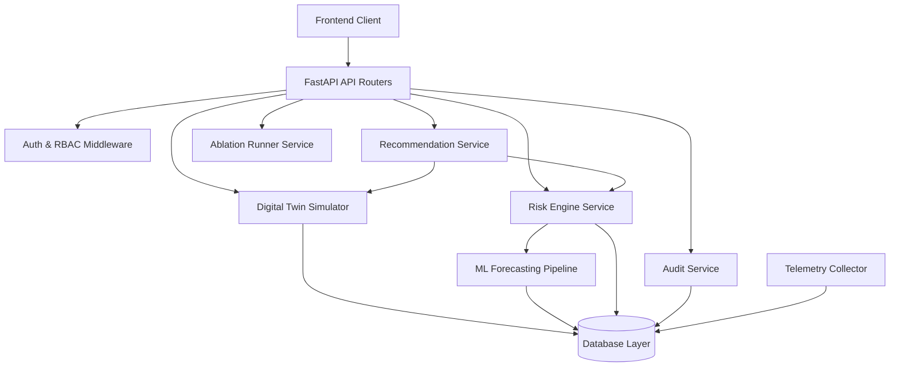

# AEGISSTOR — Architecture & Dependency Graph Audit

**Platform:** AEGISSTOR — Storage Resilience Intelligence Platform  
**Architecture Style:** Layered Service-Oriented Architecture with Digital Twin Simulation  
**Audit Date:** 2026-10-21  

---

## 1. System Architecture Diagram

```
+-----------------------------------------------------------------------------------+
|                            AEGISSTOR FRONTEND (Vite / React 19)                   |
|  - Obsidian Aurora Design Tokens (Tailwind CSS)                                   |
|  - 12 Dedicated Scientific Pages (Overview, Digital Twin, Ablations, etc.)        |
|  - Scientific Forecast Fan Charts (SVG & ECharts)                                 |
|  - Strict Typed Client (client.ts) with Error Boundaries & Request Interceptors   |
+-----------------------------------------------------------------------------------+
                                       |
                                HTTP / REST (v1)
                                       v
+-----------------------------------------------------------------------------------+
|                            FASTAPI APPLICATION LAYER                              |
|  - Request Tracing Middleware (X-Request-ID, Latency Logging)                     |
|  - JWT Authentication & Role-Based Authorization (Admin, Operator, Auditor)       |
|  - Versioned API Routers (/api/v1/overview, /telemetry, /forecasts, /twin, etc.)  |
+-----------------------------------------------------------------------------------+
       |                 |                   |                   |               |
       v                 v                   v                   v               v
+-------------+  +---------------+  +------------------+  +-------------+ +---------------+
|  Telemetry  |  | ML Inference  |  | Storage Digital  |  | Action Plan | | Audit Service |
|  Collector  |  |    Engine     |  |  Twin Simulator  |  |   Engine    | |  (Immutable)  |
+-------------+  +---------------+  +------------------+  +-------------+ +---------------+
       |                 |                   |                   |               |
       |                 |                   |                   |               |
       v                 v                   v                   v               v
+-----------------------------------------------------------------------------------+
|                               DATABASE LAYER (SQLAlchemy 2.0)                     |
|  - SQLite (Local Dev / Memory Testing) / PostgreSQL 15+ (Production Deployment)   |
|  - 14 Normalized Entity Tables with Foreign Key Constraints & Composite Indexes   |
|  - Alembic Schema Migrations with Explicit Head Revision                          |
+-----------------------------------------------------------------------------------+
```

---

## 2. Service Boundary Analysis

### A. Telemetry Collection Service (`app/collector/`)
- **Isolation**: Clean separation between synthetic generation (`synthetic.py`) and host OS telemetry (`host_collector.py`).
- **Safety Invariant**: `SHADOW_MODE_ENABLED: true` ensures zero hardware writes or disk benchmark mutations on the host system.
- **Audit Finding**: Currently, the host collector samples OS disks via `psutil`/`shutil`. Needs a Prometheus metric exporter endpoint (`/metrics`) and scrape connector for external storage agents.

### B. Machine Learning Service (`app/ml/`)
- **Isolation**: Features are generated strictly through `feature_pipeline.py` which enforces rolling windows backwards in time without future lookahead.
- **Model Implementations**: Differenced Multi-Quantile LightGBM/HistGradientBoosting, Persistence baseline, and Seasonal-Naive baseline.
- **Uncertainty Calibration**: Conformal interval adjustment module computes actual empirical coverage ($\alpha = 0.10, 0.90$) and pinball loss.
- **Audit Finding**: Model targets are currently focused on used capacity. Needs extensions for IOPS and latency target models.

### C. Digital Twin Simulation Engine (`app/simulator/`)
- **Isolation**: Runs strictly in-memory over cloned state; does not alter primary telemetry or device state.
- **Hard Safety Envelope**: Evaluates hard constraints (minimum 15% free space, maximum 25ms latency, maximum 8-hour migration budget).
- **Audit Finding**: Digital Twin simulates 5 intervention types accurately. Edge cases where all interventions violate SLA properly trigger manual investigation fallback.

### D. Security & Audit Layer (`app/services/audit_service.py`)
- **Isolation**: Every state-changing operation (scenario execution, recommendation approval, settings updates) writes to the append-only `audit_logs` table.
- **Audit Finding**: Operations currently record a fallback username if no JWT header is present. Needs full JWT token parsing and signature verification.

---

## 3. Dependency Graph & Coupling



- **Coupling Level**: Low to moderate. Services interact via typed domain schemas (`schemas/payloads.py`) and database models (`models/entities.py`).
- **Single Responsibility Principle**: Maintained. Simulators do not write telemetry, and ML models do not evaluate business recommendations.
