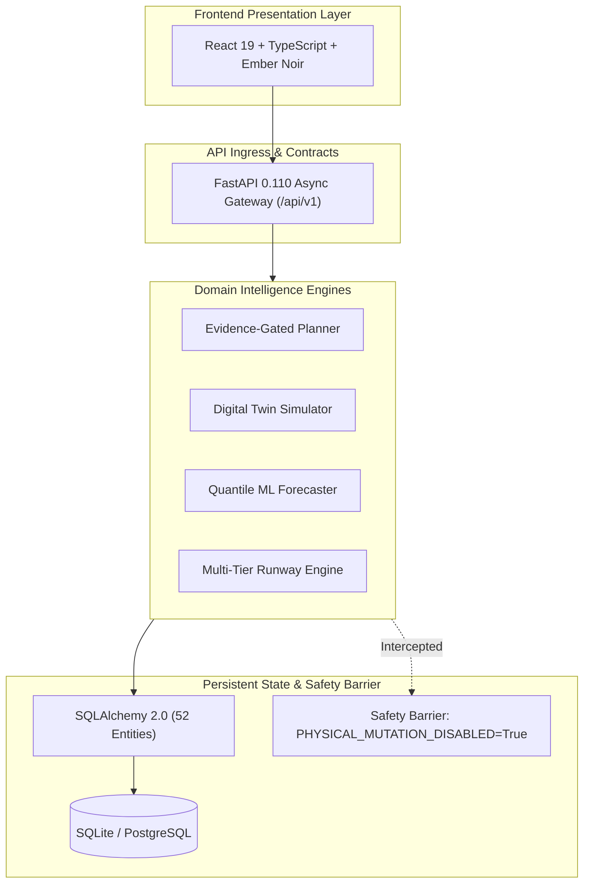

# AEGISSTOR FORGE — Technical Architecture Defense (Viva Guide)

**Project Title:** Predictive Storage Capacity and Performance Management Using Machine Learning  
**Product:** AEGISSTOR — Storage Resilience Intelligence Platform  
**Document Code:** FORGE-DEF-ARCH-001  
**Viva Examination Target:** Technical Architecture & Systems Engineering Defense  

---

## 1. Core Architectural Justification

### Question: "Why is AEGISSTOR designed as a modular monolith rather than microservices?"
**Defensible Answer:**
1. **Zero Unnecessary Network Latency:** In storage resilience and digital twin simulations, state consistency across storage pools, volumes, and shared I/O buses is critical. A modular monolith allows transactional consistency (ACID) and sub-millisecond in-process state lookups without distributed consensus overhead (e.g., Raft, two-phase commits).
2. **Resource Efficiency & Free-Tier Deployability:** Microservices impose significant idle resource footprints (each service requiring a separate container, JVM/runtime, and connection pool). AEGISSTOR's entire backend operates in $\approx 85\,\text{MB}$ RAM, qualifying it for zero-cost free-tier hosting.
3. **Strict Domain Decoupling:** Even though it is deployed as a single process, the codebase enforces strict domain boundaries:
   - Presentation: React 19 + TypeScript.
   - Gateway: FastAPI REST contracts (`/api/v1`).
   - Domain Services: Independent Python modules (`capacity_runway_engine.py`, `evidence_gated_planner.py`, `phoenix_orchestration.py`, `sovereign_service.py`).
   - Persistence: 52 isolated SQLAlchemy relational entity models.

---

## 2. In-Depth Component Interactions

### 1. Ingestion to Risk Scoring
- Observations enter through `collector/` (synthetic generator or Prometheus exporter).
- Data points pass monotonic timestamp validation and physical byte ceiling checks.
- Autoregressive feature extraction constructs causal lag and Fourier diurnal terms.
- LightGBM quantiles predict $p_{10}, p_{50}, p_{90}$ used bytes for 24h, 48h, 72h.
- `RiskEngine` calculates operational runway $T_{\text{breach}}$ against 80% warning and 90% critical thresholds.

### 2. Digital Twin Sandboxing
- The Digital Twin (`simulator/digital_twin.py`) models capacity and performance conservation equations:
  $$U_{\text{sim}}(t) = \max\left(0, U_{\text{base}}(t) - \Delta C(t)\right)$$
  $$L_{\text{sim}}(t) = L_{\text{base}}(t) \cdot \left(1 + \mu_{\text{IO}} \cdot \mathbb{I}(t \le T_{\text{action}})\right)$$
- No physical block operations are performed; simulations execute in-memory with deterministic random seeds ($S=42$).

### 3. Fail-Closed Safety Boundary
- `PHYSICAL_MUTATION_DISABLED = True` is an immutable compile-time invariant.
- Action proposals require explicit human approval and policy validation before sandbox simulation.
