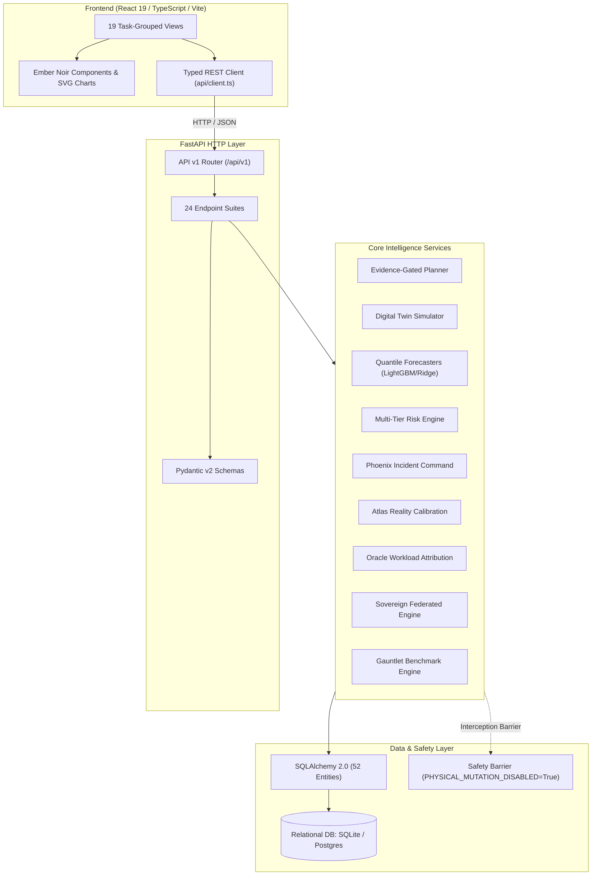

# AEGISSTOR FORGE — Dependency Architecture Map (Release Candidate 21.0)

**Project Title:** Predictive Storage Capacity and Performance Management Using Machine Learning  
**Product:** AEGISSTOR — Storage Resilience Intelligence Platform  
**Document Code:** FORGE-DEP-001  

---

## 1. System Dependency Hierarchy

AEGISSTOR maintains a strictly unidirectional, acyclic dependency topology:

---

## 2. External Package Dependencies

### Backend Dependencies (`backend/requirements.txt`)
- `fastapi >= 0.110.0`: Async web framework.
- `uvicorn >= 0.28.0`: High-speed ASGI server.
- `pydantic >= 2.6.0`, `pydantic-settings >= 2.2.0`: Strict data validation.
- `sqlalchemy >= 2.0.28`: Modern ORM and relational query builder.
- `alembic >= 1.13.0`: Database migration tracking.
- `lightgbm >= 4.3.0`: Gradient boosted trees for non-linear quantile capacity regression.
- `scikit-learn >= 1.4.0`: Autoregressive Ridge baselines and evaluation metrics.
- `pandas >= 2.2.0`, `numpy >= 1.26.0`: Tabular feature engineering and numerical matrices.
- `pyjwt >= 2.9.0`, `bcrypt >= 4.1.0`: JWT authentication and password hashing.
- `prometheus-client >= 0.20.0`: Metric exposition (`/metrics`).
- `pytest >= 8.0.0`, `httpx >= 0.27.0`: Unit and API integration testing.

### Frontend Dependencies (`frontend/package.json`)
- `react ^19.3.1`, `react-dom ^19.3.1`: Core React framework.
- `lucide-react ^1.61.0`: High-clarity SVG icon library.
- `clsx ^2.1.1`, `tailwind-merge ^3.7.0`: Dynamic utility CSS merging.
- `vite ^8.3.4`, `typescript ~6.0.3`, `tailwindcss ^3.4.17`: Bundling, strict typing, and Ember Noir tokens.
- `oxlint ^1.88.0`: Rust-based static linting.
