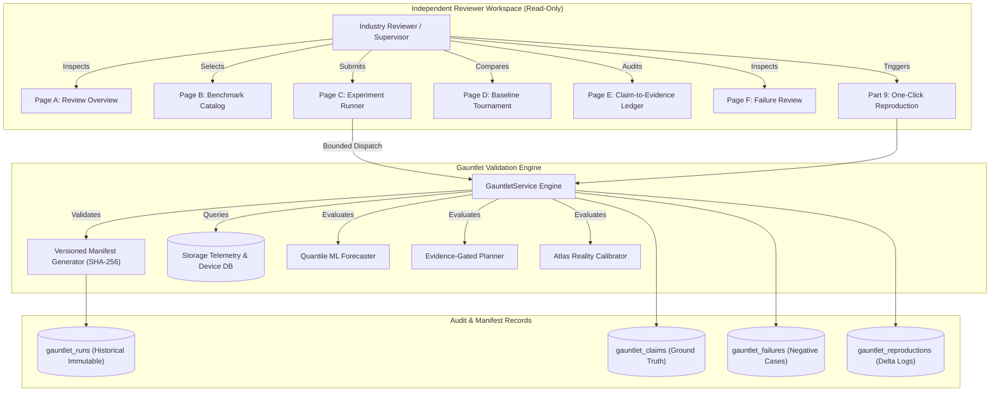

# AEGISSTOR GAUNTLET — Architecture & Examiner Workbench Specification
**Module:** GAUNTLET — Independent System Validation & Research Evidence Workbench  
**Standard:** Master Upgrade Prompt 18.0 (Parts 1, 2, 3, 10, 13)  
**System Revision:** Git Commit `87b20a5`  
**Runtime:** Python 3.13.14 on Windows x86_64 / Linux x86_64  

---

## 1. Architectural Mission & Role Separation

The GAUNTLET subsystem provides an independent, read-only audit plane designed for external examiners, academic supervisors, and industry reviewers. Unlike developer dashboards, GAUNTLET isolates experimental evaluation from production operations:

---

## 2. Core Architectural Invariants

1. **Explicit User Submission:** Benchmarks are never executed automatically on page view or navigation. Every run requires an explicit submission payload specifying justified parameter ranges.
2. **Deterministic Manifest Hashing:** Every execution produces a canonical JSON manifest hashed via SHA-256. This hash provides immutable integrity verification for the exact data split, hyperparameter set, and runtime environment.
3. **No Overwrite Policy:** Rerunning an experiment produces a new, unique `run_id`. Previous runs, intermediate logs, and negative results are preserved indefinitely in `gauntlet_runs` and `gauntlet_failures`.
4. **Strict Reviewer Authorization:** Users authenticated with role `REVIEWER` or `EXAMINER` have full read access to all benchmarks, telemetry, and evidence ledgers, but mutations (modifying claims, altering system policies, or executing physical storage operations) are blocked with HTTP `403 Forbidden`.
5. **Physical Mutation Invariant:** All benchmark suites operate exclusively against telemetry history and discrete-event counterfactual models. Physical flash block allocations or storage fabric commands remain strictly disabled.

---

## 3. Implemented Capabilities Register

| Capability | Verification Status | Code Reference | Test Suite |
| :--- | :--- | :--- | :--- |
| **Capacity Forecasting Benchmark** | **Implemented and tested** | `app/services/gauntlet_service.py` | `tests/test_gauntlet_workbench.py` |
| **Performance Contention Forecasting** | **Implemented and tested** | `app/services/gauntlet_service.py` | `tests/test_gauntlet_workbench.py` |
| **Decision Quality Tournament** | **Implemented and tested** | `app/services/evidence_gated_planner.py` | `tests/test_evidence_gated_planner.py` |
| **Robustness & Failsafe Chaos Testing** | **Implemented and tested** | `app/services/jurassic/` | `tests/test_jurassic_resilience.py` |
| **Reality Calibration (KS / Wasserstein)** | **Implemented and tested** | `app/services/atlas/` | `tests/test_atlas_fidelity.py` |
| **Hardware PCIe/SAS Bus Control** | **Demonstration only** | Synthetic abstraction layer | Unverified on physical SAN switches |

---

## 4. Database Schema Integration

The GAUNTLET plane introduces five dedicated tables in SQLite/PostgreSQL:
* `gauntlet_suites`: Canonical definitions, versions, objectives, and acceptance criteria.
* `gauntlet_runs`: Versioned runs, full manifest JSON, SHA-256 hash, and metric outputs.
* `gauntlet_claims`: Engineering claims linked to supporting run IDs and verified test paths.
* `gauntlet_failures`: Transparent log of edge cases, sensor dropouts, and rejected actions.
* `gauntlet_reproductions`: Delta comparison records tracking numerical drift against tolerances.
