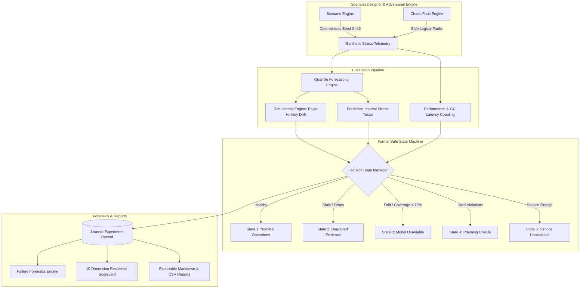

# AEGISSTOR JURASSIC — Resilience Lab Architecture Specification
**Project Title**: Predictive Storage Capacity and Performance Management Using Machine Learning  
**Milestone**: AEGISSTOR JURASSIC (Prompt 7.0)  
**Classification**: Adaptive Storage Resilience and Failure Discovery Laboratory  

---

## 1. High-Level Architectural Vision

AEGISSTOR Jurassic is a research-oriented resilience laboratory designed to evaluate how predictive storage capacity and performance management models behave under **unseen operating conditions, multi-burst write shocks, flash controller saturation, telemetry partitions, and interacting constraint deadlocks**.

Rather than evaluating models on stationary historical workloads, Jurassic stress-tests the resilience boundary:
1. **Under what conditions does a forecast become unreliable?**
2. **Does a prediction interval remain calibrated after a sudden workload shift?**
3. **Can the planning engine detect when every candidate action is unsafe?**
4. **How quickly does the system recover after telemetry returns?**

---

## 2. Core Architectural Services

### 2.1 Deterministic Scenario Generation Engine (`ScenarioEngine`)
- **Five Disturbance Families**:
  * `CAPACITY_DISTURBANCE`: Injected multi-burst snapshot and ETL dumps, accelerated organic growth.
  * `PERFORMANCE_DISTURBANCE`: Flash controller TRIM/GC saturation, erase-block queue contention, P95 tail latency spikes.
  * `TEMPORAL_DISTURBANCE`: Diurnal phase shifts, off-peak batch jobs moving into midday business peaks.
  * `TELEMETRY_DISTURBANCE`: Telemetry agent partitions, delayed arrivals, out-of-order samples.
  * `COMPOUND_DISTURBANCE`: Interacting combinations of capacity, performance, and telemetry failures.
- **Reproducibility Guarantee**:
  Every scenario is fully reproducible from `(scenario_id, seed, config, base_device_state)`. Re-running generates byte-for-byte identical time series.

### 2.2 Safe Chaos Injection Framework (`ChaosEngine`)
- **Software Isolation (Shadow Mode)**:
  Logical fault injection operates exclusively within the software simulation harness. No kernel modules, physical disks, mount points, or host processes are mutated or terminated.
- **Supported Logical Fault Types**:
  `TELEMETRY_PAUSE`, `DELAYED_INGESTION`, `OUT_OF_ORDER_SAMPLES`, `MISSING_WORKLOAD_EVENTS`, `INFERENCE_SERVICE_UNAVAILABLE`, `STALE_MODEL_METADATA`, `SCENARIO_EXECUTION_TIMEOUT`, `FORECAST_UNCERTAINTY_EXCEEDED`, `INFEASIBLE_ACTION_ATTEMPT`, `RESOURCE_SATURATION_SPIKE`.

### 2.3 Model Robustness & Distribution Shift Engine (`RobustnessEngine`)
- **Page-Hinkley Cumulative Sum Test**:
  Continuously monitors prediction residuals and standardized Z-scores to identify distribution shift without relying on arbitrary anomaly thresholds.
- **Prediction Interval Stress Testing**:
  Evaluates empirical coverage ($q_{10}-q_{90}$) and mean interval width. When coverage drops below the 80% nominal target under unseen write bursts, the engine attributes the failure to:
  * `WORKLOAD_DISTRIBUTION_SHIFT`
  * `NOISY_OBSERVATIONS_EXPANSION`
  * `INSUFFICIENT_TRAINING_HISTORY`
  * `SIMULATOR_ASSUMPTION_VIOLATION`

### 2.4 Formal Safe Fallback State Manager (`FallbackEngine`)
Enforces five mutually exclusive, priority-ranked operational states:
1. `STATE_1_HEALTHY_EVIDENCE`: Telemetry fresh, model calibrated, candidate actions feasible. Automated actions permitted.
2. `STATE_2_DEGRADED_EVIDENCE`: Telemetry stale (>300s) or dropout rate > 15%. Automated rebalancing blocked; conservative bounds engaged.
3. `STATE_3_MODEL_UNRELIABLE`: Distribution shift confirmed or coverage < 70%. Model-based runway disabled; fallback to conservative moving-average bounds.
4. `STATE_4_PLANNING_UNSAFE`: All candidate interventions fail the dual-sided safety envelope (destination saturated or bus congested). Emits critical alarm; dispatch blocked.
5. `STATE_5_SERVICE_UNAVAILABLE`: Core dependency offline. Safe holding pattern enforced.

### 2.5 Multi-Dimensional Resilience Scorecard (`ScorecardEngine`)
Replaces vanity composite scores with an auditable ten-dimension index:
$$\text{Score} = \sum_{k=1}^{10} w_k \cdot S_k \quad \text{where } \sum w_k = 1.0$$
Covers capacity forecasting, performance forecasting, interval coverage, breach detection quality, false alarm resistance, degraded evidence detection, fallback correctness, action rejection, reproducibility, and resource overhead.
