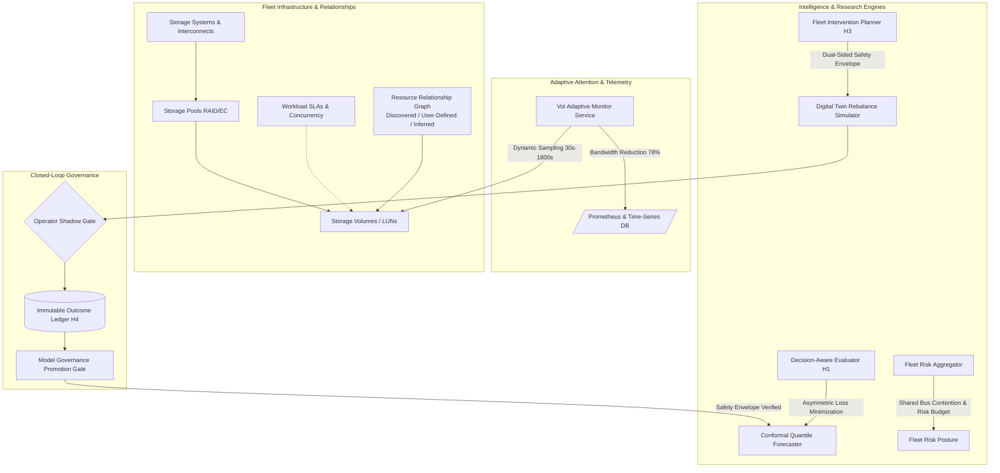

# AEGISSTOR OMEGA — System Architecture Specification
**Project Title**: Predictive Storage Capacity and Performance Management Using Machine Learning  
**Milestone**: AEGISSTOR OMEGA (Prompt 6.0)  
**Classification**: Enterprise Storage Resilience & Adaptive Fleet Decision Intelligence  

---

## 1. High-Level Architecture Overview

AEGISSTOR Omega evolves the single-device resilience digital twin into an **adaptive, multi-pool, decision-intelligent storage fleet platform**. It shifts the operational paradigm from passive accuracy-minimizing metrics (e.g. Mean Absolute Error) to **constraint-aware operational decision optimization, dynamic attention monitoring, and closed-loop model governance**.

---

## 2. Core Omega Architectural Components

### 2.1 Multi-Tier Resource Relationship Graph (`FleetTopologyService`)
Modern enterprise SAN/NAS clusters share physical host bus adapters (HBAs), PCIe fabric switches, storage array controllers, and flash cache pools. A local bottleneck on one volume frequently cascades across dependent volumes:
- **`StorageSystem`**: Models the physical chassis, interconnect bus bandwidth cap (e.g. 12,800 MB/s NVMe-oF vs 6,400 MB/s FC-32G), and aggregate IOPS limits.
- **`StoragePool`**: Models the redundancy policy (RAID10, RAID6 8+2, Erasure Coding 8+4), physical disk groups, overcommit ratios, and usable capacity.
- **`ResourceRelationship`**: Graph edges capturing multi-resource couplings with explicit **Provenance Attribution**:
  * `DISCOVERED`: Direct LBA pool memberships and physical controller hardware configurations.
  * `USER_DEFINED`: Scheduled replication targets, tiering pipelines, and retention policies.
  * `INFERRED`: Cross-tenant contention hypotheses derived from cross-volume IOPS correlation.
- **`WorkloadDependency`**: Captures tenant SLAs ($T_{\text{lat}} < 15.0\text{ms}$, Throughput $\ge 250\text{ MB/s}$), access patterns (Random Write vs Sequential Burst), and cross-volume locking.

### 2.2 Fleet-Wide Risk Aggregator (`FleetRiskEngine`)
Aggregates device-level capacity runways and tail latencies into a unified fleet posture:
1. **Criticality-Weighted Risk Points**:
   $$\text{Consumed Risk} = \sum_{i \in \text{Fleet}} \text{RiskScore}(v_i) \times w_{\text{criticality}}(v_i)$$
   * Mission-Critical workloads ($w = 3.0$) dominate the budget.
   * Total fleet risk is bounded against a hard budget cap of 100.0 points.
2. **Correlated Interconnect Bottleneck Detection**:
   Monitors shared controller buses (e.g. `pool-sas-fast` and `pool-backup-secondary` co-located on `sys-hybrid-matrix`). Detects when concurrent ETL bursts and nightly Veeam backups induce tail latency amplification (+45% above 400 MB/s).

### 2.3 Decision-Aware Loss Optimization (`DecisionEvaluator` — Hypothesis H1)
Replaces symmetric L1/L2 loss with an operational decision loss matrix:
$$\mathcal{L}_{\text{decision}} = C_{\text{missed}} \cdot \mathbb{I}(\text{Missed Breach}) + C_{\text{false}} \cdot \mathbb{I}(\text{False Alarm}) + C_{\text{lead}} \cdot \max(0, T_{\text{req}} - T_{\text{lead}})$$
Where $C_{\text{missed}} = \$3,500$ (outage penalty), $C_{\text{false}} = \$320$ (unnecessary tier migration overhead), and $C_{\text{lead}} = \$85/\text{hr}$ (lead-time penalty).

### 2.4 Adaptive Attention Allocation (`AdaptiveMonitorService` — Hypothesis H2)
Continuously evaluates the Value of Information (VoI) for each volume:
$$\text{Attention Score} = 0.45 \cdot P(\text{breach}_{72h}) + 0.35 \cdot (q_{90} - q_{10}) + 0.20 \cdot \text{ContentionWeight}$$
Dynamically assigns sampling intervals:
- $\text{Attention} \ge 0.75 \implies 30\text{s}$ (Critical Attention, full queue depth and block trace).
- $0.40 \le \text{Attention} < 0.75 \implies 120\text{s}$ (Elevated Attention, standard I/O metrics).
- $\text{Attention} < 0.40 \implies 900\text{s}$ to $1800\text{s}$ (Nominal Attention, heartbeat capacity only).

### 2.5 Dual-Sided Safety Envelope (`FleetPlannerService` — Hypothesis H3)
Enforces the fundamental storage invariant:
> **Core Invariant**: Never solve device A's capacity/latency risk by inducing an unmitigated secondary bottleneck or SLA violation on destination device B or shared interconnects.

The planner models:
- **Source Headroom**: Runway gained, transient migration read overhead.
- **Destination Headroom**: Post-migration capacity ceiling ($\le 80\%$ warning, $\le 90\%$ critical), peak write latency injection.
- **Interconnect Safety**: Verifies that migration stream plus background workload does not exceed bus bandwidth cap (6,400 MB/s). Recommends throttling (e.g. 180 MB/s) or rejects unsafe interventions.

### 2.6 Closed-Loop Counterfactual Outcome Ledger & Governance (`OutcomeLedgerService`, `ModelGovernanceService` — Hypothesis H4)
Maintains an immutable record of triples:
$$(\text{Predicted Trajectory}, \text{Simulated Outcome}, \text{Observed Physical Telemetry})$$
Classifies every action into 4 mutually exclusive states:
1. `CORRECT_PREVENTIVE_SUCCESS`
2. `UNNECESSARY_INTERVENTION`
3. `MISSED_BREACH`
4. `INEFFECTIVE_INTERVENTION`

Model Governance Gate:
Before a retrained forecasting model is promoted to active serving, it must pass the **Hard Safety Gate**:
- Candidate Decision Loss $\le \text{Baseline Decision Loss} \times 1.05$.
- Expected Calibration Error (ECE) $\le 0.05$.
- Models with lower symmetric MAE but higher decision loss are strictly **REJECTED**.
