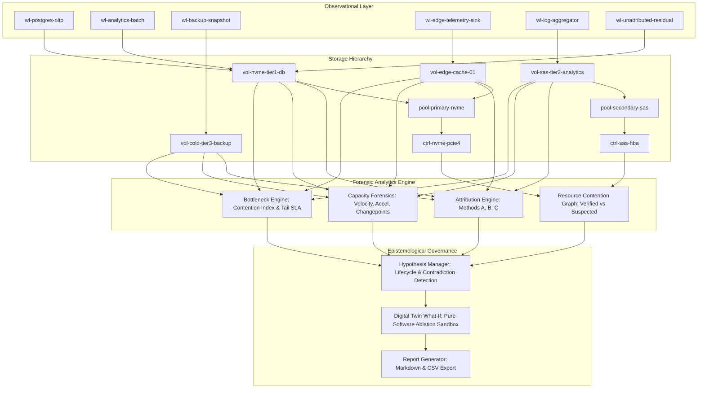

# AEGISSTOR ORACLE — Architecture Specification
**Module**: ORACLE (Workload Attribution, Bottleneck Forensics and Explainable Storage Intelligence)  
**Version**: 15.0  
**Status**: Integrated & Validated  

---

## 1. Executive Mission & Conceptual Framework

AEGISSTOR ORACLE bridges storage telemetry, digital twin simulations, capacity management, and incident orchestration by introducing an **epistemologically sound workload attribution and storage bottleneck investigation engine**.

---

## 2. Epistemological Ground Rules & Scientific Invariants

1. **Correlation $\neq$ Causation**:
   - Observational associations, time-series alignments, and statistical feature decompositions do **not** establish physical causation.
   - The platform strictly labels observational findings as `STATISTICAL_ASSOCIATION` or `SUSPECTED_CONTENTION`.
   - Only controlled counterfactual simulation or real-world experimental ablation can establish causal support within specified boundary conditions.

2. **Full Reconciliation Accounting**:
   - Physical storage pool utilization must account for 100% of used blocks.
   - The system introduces `wl-unattributed-residual` (`attribution_available=False`) to explicitly track filesystem metadata, OS journaling, copy-on-write snapshots, and untagged tenant allocations.
   - Residual storage is never concealed or arbitrarily distributed among known workloads.

3. **Zero Host Mutations**:
   - What-if counterfactual explorations (e.g. throttling, rescheduling, queue adjustments) operate purely inside the **Storage Resilience Digital Twin**.
   - Zero physical storage devices, volume mounts, or Linux cgroups are mutated during analysis.

4. **Lifecycle Promotion Guardrails**:
   - A hypothesis cannot be promoted from `DRAFT` directly to `SUPPORTED_WITHIN_CONDITIONS`.
   - Every hypothesis must transition through `READY_FOR_TESTING` and `UNDER_EVALUATION` with recorded empirical or simulated evidence.

---

## 3. Core Database Entities

| Table / Entity | Primary Purpose | Key Fields |
| :--- | :--- | :--- |
| `OracleWorkload` | Registry of business applications utilizing storage | `id`, `name`, `target_device_id`, `tier`, `workload_type`, `priority`, `sla_max_latency_ms`, `attribution_available` |
| `OracleWorkloadTelemetry` | Hourly time-series metric observations per workload | `workload_id`, `timestamp`, `allocated_bytes`, `read_iops`, `write_iops`, `throughput_mb_s`, `latency_p95_ms`, `queue_depth` |
| `OracleHypothesis` | Falsifiable investigation questions with evidence trails | `id`, `question`, `target_resource`, `workload_id`, `status`, `supporting_evidence_json`, `contradicting_evidence_json`, `confounding_variables_json` |
| `OracleBottleneckCase` | Triaged operational contention incidents | `id`, `title`, `target_device_id`, `suspected_workload_id`, `severity`, `status`, `evidence_summary`, `assigned_investigator` |
| `OracleCounterfactualExperiment` | Audit ledger of what-if simulations against Digital Twin | `id`, `target_device_id`, `workload_id`, `intervention_type`, `baseline_metrics_json`, `simulated_metrics_json`, `is_causally_proven` |

---

## 4. RESTful API Architecture

All endpoints are hosted under `/api/v1/oracle/`:

| Method | Endpoint | Description |
| :--- | :--- | :--- |
| `GET` | `/oracle/workloads` | List registered workloads and active telemetry probes |
| `GET` | `/oracle/workloads/{workload_id}` | Detailed telemetry and SLA configuration for a workload |
| `GET` | `/oracle/attribution/{device_id}` | Multi-method capacity and IOPS attribution decomposition |
| `GET` | `/oracle/capacity-forensics/{device_id}` | Velocity, acceleration, and changepoint step analysis |
| `GET` | `/oracle/bottlenecks/{device_id}` | Tail latency SLA breaches and contention index calculation |
| `GET` | `/oracle/contention-graph` | Multi-tier topology nodes and contention edges |
| `GET` | `/oracle/cases` | Operational bottleneck cases with investigator triage |
| `PATCH` | `/oracle/cases/{case_id}` | Update triage status, investigator, or resolution notes |
| `GET` | `/oracle/hypotheses` | List scientific hypotheses and evidence status |
| `POST` | `/oracle/hypotheses` | Create new hypothesis with automated contradiction checks |
| `PATCH` | `/oracle/hypotheses/{hypothesis_id}/status` | Enforce governed lifecycle transition rules |
| `POST` | `/oracle/counterfactual/run` | Execute controlled what-if Digital Twin simulation |
| `GET` | `/oracle/counterfactual/experiments` | List historical simulation runs and outcomes |
| `GET` | `/oracle/report/{device_id}` | Generate comprehensive structured investigation report |
| `GET` | `/oracle/report/{device_id}/export` | Export investigation findings in Markdown or CSV |
