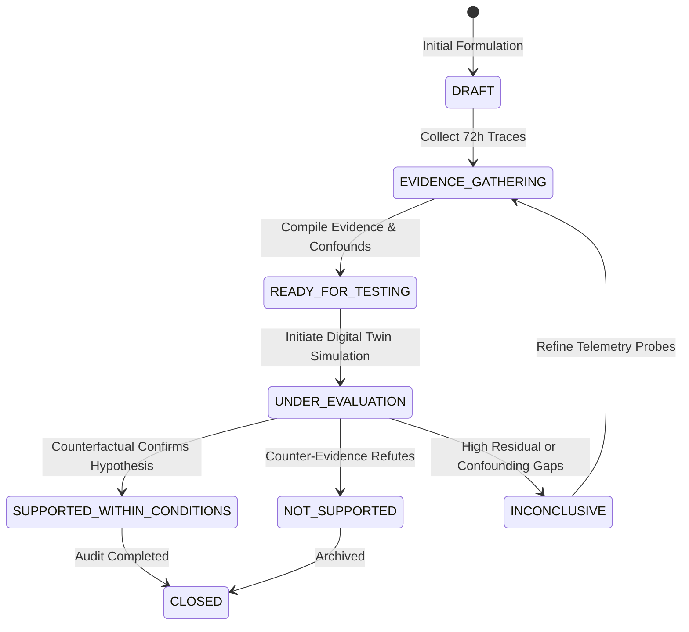

# AEGISSTOR ORACLE — Evidence Model & Hypothesis Lifecycle
**Document**: Epistemological Governance, Evidence Schema & Contradiction Detection  
**Module**: ORACLE Hypothesis Manager  
**Status**: Validated  

---

## 1. Epistemological Levels of Knowledge

ORACLE enforces strict boundaries between four epistemic categories:

1. **Empirical Fact**:
   - Directly measured physical telemetry (e.g. queue depth, P95 tail latency, host read/write bytes, aggregate pool capacity).
   - Timestamped, audited, and immutable.

2. **Statistical Association**:
   - Observational correlations, feature importance rankings, changepoint coincidences.
   - Strictly flagged: *Correlation $\neq$ Causation*.

3. **Simulated Counterfactual**:
   - What-if outcomes produced inside the Digital Twin software model.
   - Reflected as conditional estimates given model assumptions; never confused with real ground truth.

4. **Governed Hypothesis**:
   - Falsifiable proposition subject to affirmative validation, counter-evidence discovery, and confound identification.

---

## 2. Hypothesis Lifecycle State Machine



### Lifecycle Invariants & Promotion Guards
- Promoting a hypothesis directly from `DRAFT` to `SUPPORTED_WITHIN_CONDITIONS` throws a strict `ValueError`.
- A hypothesis must transition through `READY_FOR_TESTING` and `UNDER_EVALUATION`.
- Every transition appends an audit event to `status_history` recording `previous_status`, `new_status`, `reviewer`, `timestamp`, and `rationale`.

---

## 3. Automated Contradiction Detection

Before persisting or evaluating any hypothesis, ORACLE runs three automated contradiction checks:

1. **Topological Disconnect Check**:
   - Evaluates whether the suspected workload is physically mapped to the suspected target resource.
   - *Example Flag*: `"Topological Disconnect: Workload 'wl-backup-snapshot' is mapped to 'vol-cold-tier3-backup', not suspected resource 'vol-nvme-tier1-db'. Direct I/O causation is physically impossible unless a shared backend fabric is involved."*

2. **Attribution Capability Check**:
   - Verifies whether the suspected workload has granular telemetry instrumentation enabled (`attribution_available=True`).
   - *Example Flag*: `"Attribution Limitation: Workload 'wl-unattributed-residual' does not have granular telemetry probes enabled. Claims regarding its individual contribution cannot be empirically verified from current metrics."*

3. **Telemetry Quality / Dropout Check**:
   - Inspects target device time-series for telemetry gaps or missingness.
   - If missingness $> 5.0\%$, flags data quality confounding.

---

## 4. Evidence Structure Schema

```json
{
  "id": "hyp-oracle-lat-01",
  "question": "Does concurrent nightly execution of wl-analytics-batch cause observed P95 latency spikes on vol-nvme-tier1-db?",
  "target_resource": "vol-nvme-tier1-db",
  "workload_id": "wl-analytics-batch",
  "status": "READY_FOR_TESTING",
  "supporting_evidence": [
    "P95 latency surges from 1.4ms to 18.2ms precisely between 01:00 and 04:00.",
    "Analytics batch job logs confirm 3,200 IOPS arrival rate during the same window."
  ],
  "contradicting_evidence": [
    "PCIe Gen4 bus throughput stays under 65% of rated hardware limit.",
    "Similar batch executions on Tuesday showed only a 4.1ms latency rise."
  ],
  "confounding_variables": [
    "Co-occurring OS security vulnerability scanning at 02:00.",
    "Database index re-indexing scheduled concurrently on alternate partition."
  ],
  "proposed_evaluation_method": "CONTROLLED_DIGITAL_TWIN_THROTTLING",
  "conclusion": null,
  "reviewer": "lead_sre@aegisstor.internal"
}
```
