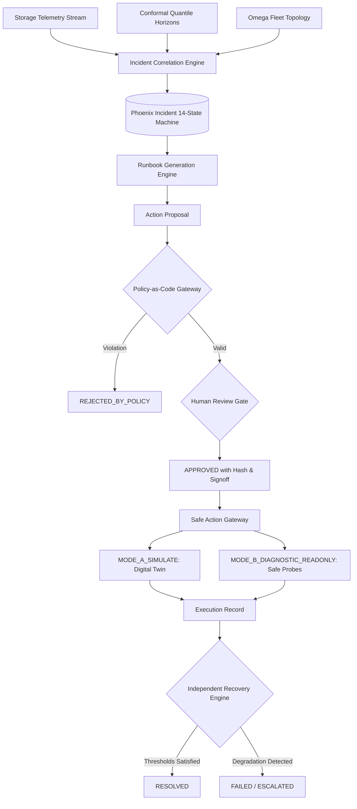

# AEGISSTOR PHOENIX — Safe Self-Healing Storage Operations & Incident Orchestration
## System Architecture & Orchestration Specification

### 1. Vision & Architectural Role
AEGISSTOR PHOENIX bridges predictive telemetry analytics with deterministic, auditable incident remediation. While the AEGISSTOR forecasting core computes quantile trajectories ($Q_{10}, Q_{50}, Q_{90}$) and Jurassic tests system robustness against chaos disruptions, PHOENIX manages the operational incident lifecycle from predictive detection through policy-gated mitigation and post-action recovery verification.

### 2. Core Pillars of PHOENIX
1. **Provenance & Evidence Classification**:
   Explicitly distinguishes between `PREDICTED`, `OBSERVED`, `SIMULATED`, `RESOLVED`, and `INSUFFICIENT_EVIDENCE`. Hypotheses are classified as `CONFIRMED_OBSERVATION`, `SUPPORTED_HYPOTHESIS`, or `UNCONFIRMED_HYPOTHESIS`.
2. **Persistent 14-State Lifecycle Machine**:
   Enforces a strict directed graph from `DETECTED` to `RESOLVED`, with fail-closed state transitions. Illegal state jumps (such as `DETECTED` $\to$ `RESOLVED`) are strictly blocked.
3. **Policy-as-Code Safety Gateway**:
   Evaluates non-bypassable safety invariants (minimum reserve $\ge 10.0\%$, P95 latency $\le 20.0$ ms, bandwidth cap $\le 6400$ MB/s). High recommendation confidence can never override a safety violation.
4. **Safe Action Gateway & Zero Physical Mutations Guarantee**:
   All mitigation operations run strictly in simulation (`MODE_A_SIMULATE`) or read-only sampling (`MODE_B_DIAGNOSTIC_READONLY`). Controlled host execution (`MODE_C`) is disabled by default. No destructive disk commands (`rm`, `mkfs`, `dd`, `fdisk`) exist in the codebase.
5. **Tamper-Evident Approval Workflow**:
   Proposals compute a SHA-256 hash over action parameters and target resources. Post-approval mutations invalidate the hash and block execution.
6. **Idempotent Execution**:
   Enforces unique idempotency tokens, preventing duplicate executions of recovery runs.
7. **Independent Recovery Verification Engine**:
   Ensures that a successful execution API call is never confused with true storage recovery. The post-action telemetry window is audited for threshold compliance and lack of secondary degradation.
8. **Incident Evidence Graph & Repeated Incident Learning**:
   Constructs directed provenance trees and analyzes recurring incident patterns, calculating MTTR and formulating architectural prevention advice.
