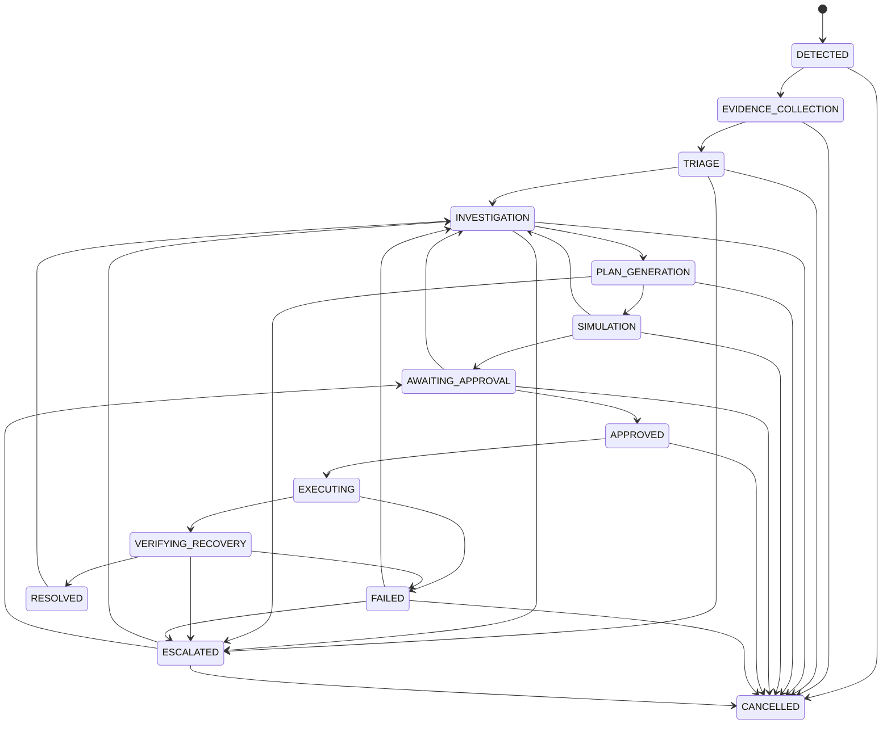

# AEGISSTOR PHOENIX — Persistent 14-State Incident Lifecycle Machine

## 1. Lifecycle State Definitions

| State Index | State Name | Phase Category | Description |
|:---|:---|:---|:---|
| 1 | `DETECTED` | Ingestion | Initial candidate flag raised by telemetry breach or conformal forecast horizon. |
| 2 | `EVIDENCE_COLLECTION` | Telemetry & Modeling | Gathers multi-tier telemetry, device configuration, and quantile projections. |
| 3 | `TRIAGE` | Severity & Topology | Evaluates blast radius, affected pool resources, and severity (`SEV1`–`SEV4`). |
| 4 | `INVESTIGATION` | Root Cause Analysis | Formulates hypotheses (`CONFIRMED_OBSERVATION`, `SUPPORTED_HYPOTHESIS`). |
| 5 | `PLAN_GENERATION` | Mitigation Synthesis | Generates candidate runbook mitigation proposal tailored to category. |
| 6 | `SIMULATION` | Digital Twin Evaluation | Simulates headroom gain and latency trade-offs in scenario engine. |
| 7 | `AWAITING_APPROVAL` | Governance Gate | Submitted to operator review; awaits authorized engineering signoff. |
| 8 | `APPROVED` | Verified Proposal | Proposal hash validated; authorized engineer recorded with rationale. |
| 9 | `EXECUTING` | Action Dispatch | Dispatched to Safe Action Gateway with idempotency token (`MODE_A`/`MODE_B`). |
| 10 | `VERIFYING_RECOVERY` | Post-Action Window | Observes telemetry window (12–24h) for metric recovery and absence of secondary degradation. |
| 11 | `RESOLVED` | Terminal Success | Independent verifier confirms operating metrics returned to nominal boundaries. |
| 12 | `FAILED` | Terminal / Exception | Action failed to resolve breach, or introduced secondary degradation. |
| 13 | `ESCALATED` | Human Engineering | Requires architectural intervention, manual disk replacement, or migration. |
| 14 | `CANCELLED` | Operator Dismissal | Incident dismissed due to workload cessation, decommission, or operator override. |

---

## 2. Directed State Transition Graph

---

## 3. Transition Validation Rules
1. **Illegal Jump Prevention**: Any transition not explicitly registered in `VALID_TRANSITIONS` raises `InvalidStateTransitionError` and returns `HTTP 400 Bad Request`.
2. **Execution Gate**: An incident cannot transition to `EXECUTING` unless the proposal has status `APPROVED` and its SHA256 parameter hash remains untampered.
3. **Resolution Gate**: An incident cannot transition to `RESOLVED` directly from `EXECUTING`. It must pass through `VERIFYING_RECOVERY` and receive a `RECOVERY_SATISFIED` verdict from `RecoveryVerifier`.
