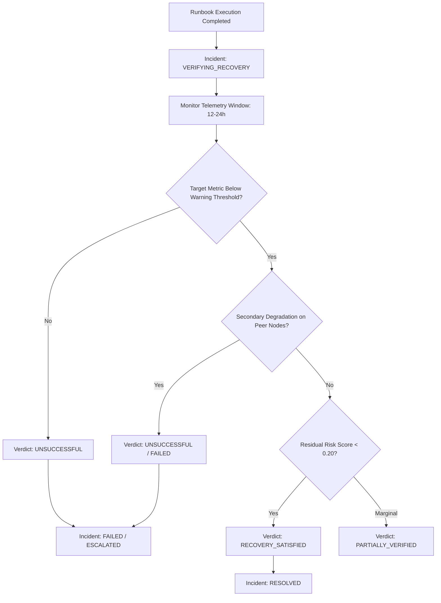

# AEGISSTOR PHOENIX — Independent Recovery Verification Engine

## 1. The Core Principle: API Success $\ne$ Physical Recovery
In enterprise storage engineering, executing a remediation command (e.g. initiating rebalance or evicting snapshots) does not constitute proof that the incident is resolved. The filesystem may experience secondary degradation, queue lockups, or metadata fragmentation.

Therefore, PHOENIX enforces that an incident *cannot* transition directly from `EXECUTING` to `RESOLVED`. Instead:
1. Incident transitions to `VERIFYING_RECOVERY`.
2. An independent verification engine monitors telemetry across an observation window (12 to 24 hours).
3. The engine evaluates both primary target metrics and secondary side-effects.

---

## 2. Verification Criteria & Invariants

### Evaluated Invariants:
- **Primary Threshold Recovery**: Utilization must drop below the device warning threshold ($< 80.0\%$), or P95 latency must normalize ($< 20.0\text{ ms}$).
- **Secondary Degradation Guard**: Peer devices in the storage pool or controller queue depths must not exhibit spike anomalies.
- **Residual Risk Target**: Multi-variate risk score must drop below $0.20$.

---

## 3. Recovery Verification Verdicts

| Verification Status | Meaning | Resulting Incident State |
|:---|:---|:---|
| `RECOVERY_SATISFIED` | All primary and secondary metrics normalized. | `RESOLVED` |
| `PARTIALLY_VERIFIED` | Target metric improved, but remains near warning boundary. | Remains in `VERIFYING_RECOVERY` |
| `INCONCLUSIVE` | Telemetry readings flat or insufficient variance to confirm. | Remains in `VERIFYING_RECOVERY` |
| `UNSUCCESSFUL` | Target metric continues to breach threshold, or secondary failure detected. | `FAILED` or `ESCALATED` |

Verified in **Drill G** (`test_drill_g_recovery_verification_unsuccessful`) and **Drill H** (`test_drill_h_recovery_verification_successful_resolution`).
