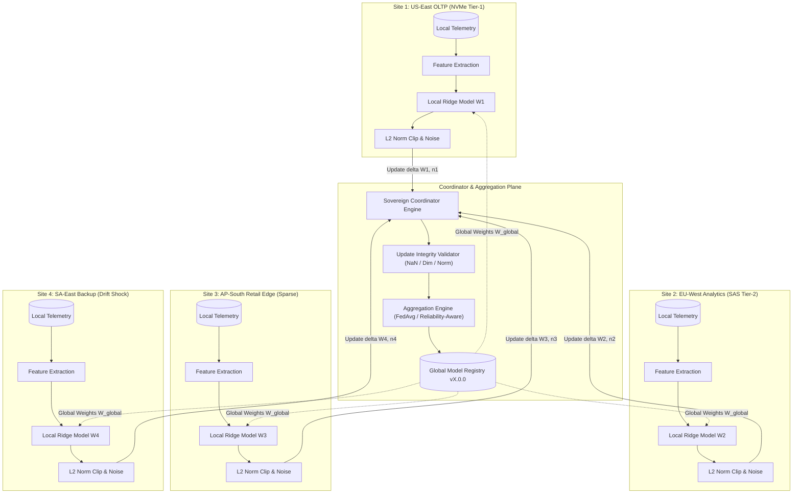

# AEGISSTOR SOVEREIGN — Multi-Site Federated Architecture
**Module:** SOVEREIGN — Privacy-Conscious Federated Storage Intelligence  
**Standard:** Master Upgrade Prompt 19.0 (Part 1 & Part 13)  
**System Revision:** Git Commit `afba39c`  
**Execution Runtime:** Python 3.13.14, SQLite WAL Mode / PostgreSQL  

---

## 1. Architectural Mission & Separation of Concerns

SOVEREIGN enables heterogeneous enterprise storage clusters to collaboratively train and improve storage forecasting models without centralizing raw telemetry data.

---

## 2. Information Boundaries (What Stays Local vs What Is Transmitted)

| Layer | Information Content | Physical Location | Shared with Coordinator? |
| :--- | :--- | :--- | :---: |
| **Layer 1: Raw Telemetry** | 60-second time series: `used_bytes`, read/write IOPS, p95 latency, queue depth. | Local Site Database / Filesystem | **NO (100% Withheld Locally)** |
| **Layer 2: Derived Local Features** | Diurnal Fourier terms ($\sin, \cos$), rolling ratios ($\text{MA}_6, \text{MA}_{24}$), normalized state. | Local Memory Buffer | **NO (Withheld Locally)** |
| **Layer 3: Local Model Weights** | Parameter vector $W_k \in \mathbb{R}^8$, scalar bias $b_k \in \mathbb{R}$. | Local Model Store | **YES (Encapsulated in Update)** |
| **Layer 4: Update Metadata** | Sample count $n_k$, local validation RMSE, update norm $||W_k||_2$. | SovereignUpdate Record | **YES (Used for Aggregation Weight)** |
| **Layer 5: Aggregated Artifact** | Global parameter vector $W_{\text{global}}$, version $vX.0.0$. | SovereignGlobalModel Store | **YES (Broadcasted to Sites)** |

---

## 3. Database Schema Mapping

The Sovereign module introduces five database models:
1. `sovereign_sites`: Registered storage nodes, regions, workload types, local sample counts, and reliability scores.
2. `sovereign_rounds`: Federated training rounds, strategies (`FED_AVG`, `RELIABILITY_AWARE`, `PERSONALIZED`, `DIFFERENTIAL_PRIVACY`), and rejection counts.
3. `sovereign_updates`: Parameter update records with validation flags and assigned weights.
4. `sovereign_global_models`: Immutable versioned global model artifacts.
5. `sovereign_experiments`: Multi-round benchmark comparison manifests hashed via SHA-256.
