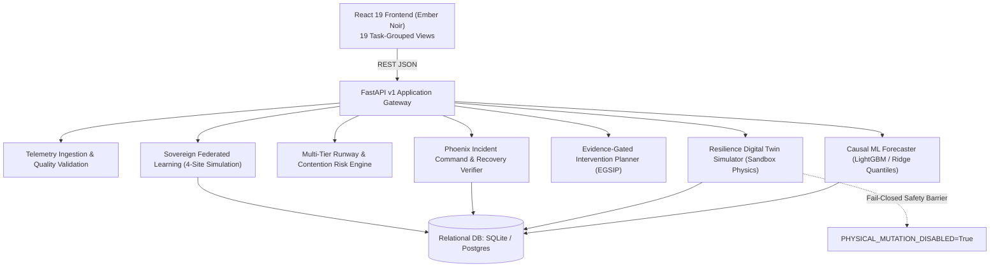

# Submission Deliverable: System Architecture & Data Flow

**Platform:** AEGISSTOR — Storage Resilience Intelligence Platform  
**Document:** SUBMISSION-ARCH-001  

---

## 1. System Topology

AEGISSTOR implements a layered modular architecture that balances operational performance with research reproducibility:

---

## 2. Core Modules & Subsystems

1. **Telemetry Collector:** Validates units, monotonic timestamps, positive byte counts, and assigns provenance labels.
2. **Causal ML Forecaster:** Autoregressive Ridge and LightGBM quantile regression ($p_{10}, p_{50}, p_{90}$) enforcing strict chronological splits without future data leakage.
3. **Multi-Tier Risk Engine:** Computes reserve runway ($T_{\text{breach}}$) and queue depth contention risks.
4. **Digital Twin Sandbox:** Deterministic counterfactual simulation of capacity expansion, cold data tiering, and workload rebalancing.
5. **Evidence-Gated Planner (EGSIP):** Primary candidate contribution. Evaluates uncertainty spread, simulator discrepancy, and warning lead times before proposing action.
6. **Phoenix Incident Orchestration:** Correlates multi-metric alerts, provides human-in-the-loop policy signoff, and executes 6-cycle recovery verification.
7. **Sovereign Federated Learning:** Decentralized 4-site simulation maintaining 100% local telemetry privacy with differential privacy noise and an adversarial update integrity shield.
